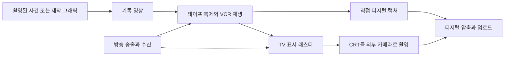

# 아날로그 호러 시각 의미·후보 데이터 보강 리서치

2026-10-22. [참조 대화](https://chatgpt.com/c/6ada007f-29a4-83ee-a3ec-6db4fb772afc)의 200개 용어와 8개 창작 조합을 출발점으로 삼았다. 아래 결과는 연구와 반영 설계다. 운영 후보 등록·검색 평가·이미지 생성은 아직 실행하지 않았다.

핵심 판단은 **아날로그 호러라는 장르 이름보다, 무엇이 기록됐고 어떤 경로로 전달되며 어디서 신뢰가 흔들리는지를 데이터로 표현해야 한다**는 것이다. 낡은 색감·주사선·기괴한 얼굴을 한 묶음으로 늘리는 방법은 장소·매체·인과가 다른 후보를 섞는다. 장르의 창작적 효과 역시 질감 몇 개만으로 보증할 수 없다.

## 1. 조사 범위와 근거의 등급

200개 원 항목을 모두 보존했다. 복합 용어를 여러 카드로 나누더라도 원 번호는 유지한다. 78개 카드는 가시 성분·소유자·방향 관계·혼동 경계·한영 표현·출처 범위·픽셀 검토 기준을 가진다. 이 중 72개를 후보 초안으로 작성했고, 세부 근거가 더 필요한 6개는 보류했다. **200 용어·78 카드·72 초안은 서로 중첩되는 수치다.**

처리 경로는 가시 실현 또는 proxy 56, 혼합 40, 문맥 64, 시간 7, 비시각 15, 판본 18이다. 이 경로는 용어의 영구적인 본질 분류가 아니라 이번 정지 이미지 시스템에서의 반영 방침이다. 예를 들어 모방 존재는 외형 대응을 제안할 수 있지만 모방 능력·인물 대체 사건은 문맥으로 남긴다.

출처 장부는 38개다. 그중 33개는 본문의 필요한 부분을 읽었고, 5개는 landing·초록/검색·부분 본문 수준으로 제한된다(S15·S22·S26·S34·S38). 본문을 읽었다는 사실도 전체 원작·전체 판본을 검증했다는 뜻은 아니다. 200개의 개별 정의를 모두 독립 사전·논문에서 검증했다고 주장하지 않는다. 실제 접근 범위는 [SOURCES.tsv](SOURCES.tsv)에 기록했다. 연구자가 설계한 구체적인 장면은 출처의 장면 설명과 구분한다.

기술 정의는 [Canadian Conservation Institute](https://www.canada.ca/en/conservation-institute/services/conservation-preservation-publications/technical-bulletins/digitization-vhs-video-tapes.html), 각 [AVAA 오류 항목](https://www.avartifactatlas.com/artifacts/tracking_error.html), [Seattle Municipal Archives 매뉴얼](https://mediaarea.net/QCTools/Seattle_Municipal_Archives_Manual)을 중심으로 대조했다. 작품의 창작 선택은 [Kris Straub의 제작기](https://www.patreon.com/krisstraub/posts/new-horror-on-58-4114380), [Remy Abode 인터뷰](https://fnewsmagazine.com/2022/02/ghosts-in-the-machine-archiving-the-end-of-the-world-with-gemini-home-entertainment/), [Alex Kister 인터뷰](https://fnewsmagazine.com/2022/01/ghosts-in-the-machine-the-fearful-symmetry-of-alex-kisters-the-mandela-catalogue/)의 당사자 설명과 비평가의 해석을 나눠 읽었다.

## 2. 매체의 경로를 먼저 결정해야 한다

아래는 가능한 경로를 설명하는 모델이다. 모든 장면이 이 경로 전체를 거친다는 뜻이 아니다.

직접 디지털 캡처한 영상에는 TV 외함·유리 반사가 자동으로 필요하지 않다. 반대로 TV를 찍은 사진에서는 화면 안의 잡음과 화면 밖 방의 표면을 구분해야 한다. 필름을 방송하고 VHS에 녹화한 뒤 디지털로 재압축했다는 경로를 명시했다면 필름 흠집·비디오 결함·디지털 블록이 공존할 수 있다. 경로 없이 모든 흔적을 더하는 것은 근거가 약하다. 이 경로 모델과 구체적인 조합 방침은 이번 연구의 설계 판단이다.

`VHS`는 기록 형식, `VCR`은 장비, `CRT`는 표시 부품이다. [Science Museum Group의 소장품](https://collection.sciencemuseumgroup.org.uk/objects/co8406906/cathode-ray-tube)은 컴퓨터 메모리용 CRT도 설명한다. 따라서 CRT라는 말만으로 가정용 TV 전체를 추가하면 범위가 넓어진다. NTSC/PAL/SECAM 역시 저장 형식과 다른 신호 규격이다. [ITU BT.470](https://www.itu.int/rec/R-REC-BT.470/en)은 이번에는 표준의 제목·판본까지만 확인했으며 상세 수치 복원은 별도 과제다.

## 3. 영상 결함의 혼동을 줄이는 구체적 보강

|구분|정지 이미지에서 확인할 성분·관계|거절할 대체물|남는 검증|
|---|---|---|---|
|Tracking error / A018|재생 영상 일부를 가리는 넓고 불규칙한 가로 띠|등간격 주사선, 카메라 추적|실제 헤드·트랙 불일치 진단|
|Dropout / A019|영상 정보 일부를 끊는 짧고 가는 밝거나 어두운 수평 줄|테이프 플라스틱의 줄, 전체 static|순간적 발생·신호 손실 원인|
|Head switching / A020|전체 캡처 래스터의 맨 아래에 붙은 가는 왜곡 띠|중앙의 두꺼운 트래킹 띠|실제 재생 과정|
|Time-base error / A021|영상 속 수직 윤곽이 휘되 외부 프레임 경계는 유지|실제 휜 건축, 광각 렌즈|신호 타이밍과 장비 원인|
|Chroma bleed / A023|밝기 윤곽 바깥으로 퍼진 색|그냥 흐림, 저채도 팔레트|신호 경로·처리 원인|
|Y/C delay / A024|밝기 경계와 채색 경계의 상대 위치 차이|임의 프리즘 효과, 단순 퍼짐|실제 시간 지연 측정|
|Dot crawl / A025|고채도 경계를 따라 놓인 촘촘한 점 열|전체 화면의 입자, 사각 블록|프레임 간 움직임|
|Transmission ghost / A026|같은 윤곽이 수평으로 어긋난 옅은 복제|렌즈 반사 원반, 귀신|수신 지연·반사 경로|
|Image lag / A027|밝은 광원과 이어진 옅어지는 꼬리|수평 동일 윤곽 복제, 플레어 구슬|카메라 장치·잔류 시간|
|Scanlines / A006|표시 래스터 내부의 미세하고 균일한 가로 선|잡음 띠, 피부·벽 무늬|실제 표시 방식|
|Interlace combing / A028|움직이는 윤곽에 한정된 교대 가로 빗살|화면 전체의 균일한 선|필드 시차·병합 경로|
|Bloom / A029|밝은 대상에 중심이 있는 국소 팽창|화면 전체 안개|카메라·표시장치·후처리 중 실제 원인|
|Overscan / A030|같은 영상의 전체 보기와 잘린 가장자리 대응|한 장에서 원본 밖 내용을 추정|원본·표시 영역 비교|
|Generation loss / A031|같은 구도의 더 무른 윤곽·증가한 잡음 비교|어두운 사진, 임의 저해상도|실제 복제 이력|
|Digital blocks / A037|국소적으로 나뉜 직사각형 색 블록|VHS 고유 결함이라는 설명|디지털 전송·코덱 경로|

표의 시각 예는 저술한 평가 제안이다. 정의의 근거와 외형만으로 확정할 수 없는 인과를 분리했다. 특히 [Y/C 지연](https://www.avartifactatlas.com/artifacts/yc_delay_error.html), [수신 겹상](https://www.avartifactatlas.com/artifacts/ghost.html), [카메라 잔상](https://www.avartifactatlas.com/artifacts/image_lag.html)은 현재의 검색 오탐을 고치는 데 바로 쓸 수 있는 구분이다.

## 4. 방송·문서의 형식은 정보의 관계로 표현한다

공익 안내는 짧은 지침과 행동 도해, 사내 교육은 장비와 절차 도해, 자연사는 생물과 서식지 도판, 실종 공고는 사진과 식별 정보의 관계로 표현했다. 이들은 각각 A040~A048의 선택형 실현이다. 특정 괴물·실제 어린이·실제 기관·위협을 자동 삽입하지 않는다.

방송국 식별(A011), 컬러바(A012), 경보(A013~A014), 텔레텍스트(A015), OSD(A004), 프레임 주소(A016), VCR 카운터(A017)는 따로 둔다. 글자는 물리 표지·영상 내부 오버레이·영상 밖 캡션 중 어느 층에 속하는지 명시한다. 긴 문서 전체를 생성기로 읽히게 하는 대신 짧은 핵심 문구만 선택하고, 정확한 글자가 필요하면 생성 원본과 후처리 합성본을 따로 평가한다.

[NOAA 설명](https://www.weather.gov/nwr/eas_description)은 EAS와 NWR의 동일한 디지털 프로토콜을 확인해 준다. [SAME 연혁](https://www.weather.gov/sgf/nwr_same)에 따르면 EAS는 1997년 EBS를 대체했다. 따라서 1983년 EBS 자료풍과 현대 EAS/SAME를 같은 기본 후보로 합치지 않는다. 모든 실제 경보 화면이 하나의 고정 레이아웃이라는 뜻도 아니다. 이번 A014는 저술한 화면 예다.

Teletext는 방식이고 Ceefax는 BBC 서비스다. [BBC의 1970년대 자료](https://downloads.bbc.co.uk/historyofthebbc/1970s.pdf)로 도입 맥락은 확인했지만 정확한 문자 격자·페이지 규격은 추가 대조가 필요해 A015의 운영 후보 초안화를 보류했다. 컬러바 역시 일반 시험 화면과 특정 표준의 정확한 패턴을 분리하고 A012를 보류했다.

## 5. 서사 의미를 정지 픽셀의 사실로 승격하지 않는다

기록 불일치(A050)는 서로 다른 표기만 보여 준다. 누가 은폐했는지, 어느 쪽이 진실인지는 별개다. 빈 보관 칸(A051)은 누락의 정황이지 삭제 행위의 증거가 아니다. 충돌하는 지침(A054)은 같은 문·조건을 대상으로 하는 읽을 수 있는 반대 문구가 필요하다. 출구 표시와 막힌 문(A055)은 불일치의 예지만 살해 의도나 실제 피해를 증명하지 않는다.

TV 내부와 외부(A049), 경계를 가로지르는 연속 형상(A056)은 소유자·좌표계가 핵심이다. 화면 안과 밖의 인물을 합치거나, 검은 화면을 화면 밖 존재의 구현 성공으로 세지 않는다. [BFI의 Ring 비평](https://www.bfi.org.uk/features/ringu-hideo-nakata-videotapes-lynch-haneke)은 매체의 물성과 가정 공간 침입을 논하지만, 이 연구의 구체적인 비인간 띠 형태는 새로 저술한 제안이다.

Slow burn, jump scare, protocol escalation, missing footage의 시간적 의미, 재맥락화, 현재 관객의 기억 인식은 전후 장면·지속 시간·관객 반응 또는 명시 설정이 필요하다. 단독 스틸의 평가 항목으로 만들지 않는다. [Night Mind의 운영 분류](https://www.nightmind.info/index)는 관객 상호작용이 필요한 정도로 ARG·선택형 상호작용·재생형 서사를 구분한다. 암호나 URL이 있는 이미지 하나를 ARG의 성공 증거로 보지 않는다.

## 6. 인지·음향·데이터 도해의 경계

소리의 테이프 히스·험·룸톤·드론·방송 침묵·역재생·하울링은 비시각 경로다. [와우·플러터](https://www.avartifactatlas.com/artifacts/wow_and_flutter.html)는 재생 속도의 불규칙과 음높이 변화이므로, 음을 낮추거나 테이프가 보인다는 이유로 구현됐다고 평가하면 안 된다. 음향 맥락은 보존하고 정지 이미지의 필수 시각 후보에서는 제외한다.

[모리의 원문 승인 번역](https://spectrum.ieee.org/the-uncanny-valley)은 인간 유사성과 친밀감에 관한 가설이다. A057의 인공 눈·기계 이음매는 특정 외형 제안일 뿐 관객의 불쾌감을 보증하지 않는다. Pareidolia의 얼굴 같은 배열(A058) 역시 실제 얼굴·괴물과 분리하며, 독립 심리 연구 원전 확보 전 후보 초안은 보류했다.

[USGS의 스펙트로그램 설명](https://earthquake.usgs.gov/monitoring/spectrograms/about.php)은 시간·주파수·강도 관계를 보여 준다. [ARISS의 SSTV 운용](https://www.ariss.org/tips-and-techniques.html)은 신호를 받아 이미지를 복원하는 과정이다. 따라서 A074는 축과 강도 도해, A075는 수신기-컴퓨터-이미지의 배치로 나눈다. 어느 쪽의 이미지도 실제 숨긴 음성·수신·해독 성공의 증거는 아니다. 진짜 해독을 주장하려면 입력 파일과 처리 결과를 재현해야 한다.

## 7. 인접 호러와 민감한 항목의 반영

몸의 변형·복합 신체·기생 접점·유기 건축은 기존 biopunk/body-horror·cosmic·medical 자료와 대조한다. [BFI의 바디 호러 논의](https://www.bfi.org.uk/lists/10-great-body-horror-films)가 다루는 몸의 통제·자율성은 유혈의 양과 다르다. 기존 `living architecture`의 벽-막-도관 관계와 의미가 같으면 전체 레코드를 재사용한다. 단순히 아날로그 교육 테이프 안에 표시된다는 이유로 같은 생물 구조를 새 후보로 중복 등록하지 않는다.

원 대화의 139~167번도 모두 유지했다. 고어/스플래터, 신체 손상/절단, 부패/시간, 부검/생체 해부, 식인/재료의 인간 기원, 고문/충격 중심 비평, 감금/의식/생사를 구분한다. 156~166번의 욕망·성적 매혹·관음·비동의 촬영·성폭력·그루밍·생식 강압·혈연·시체성애·대상화는 서로 다른 맥락이다. 노출·표정·카메라 각도·의료 장비로 이 관계와 의도를 확정하지 않는다. 위협·피해·동의를 시각적 미학의 기본값으로 추가하지 않는다.

[WHO 정의](https://www.who.int/news-room/fact-sheets/detail/child-maltreatment)는 보호·신뢰·권력 관계를 포함한다. 외상처럼 보이는 사진만으로 학대 관계를 확정할 수 없다는 설계 판단을 적용했다. 생식 강압의 ACOG 원문은 접근이 막혀 별도 확인 과제로 남겼다. [BBFC의 역사 설명](https://www.bbfc.co.uk/film-media-resources/legislation/the-video-recordings-act)에 따른 Video nasty는 역사적 유통·검열 맥락으로 처리하며 괴물·질감 후보로 추가하지 않는다.

## 8. 정보재해·작품 고유어는 별도의 문맥과 판본을 가진다

[SCP 공식 용어집](https://scp-wiki.wikidot.com/glossary-of-terms)의 cognitohazard, infohazard, memetic, antimemetic과 mimetic을 구별한다. A073의 정보 가림은 가시 문서 상태다. 이를 본 사람이 기억을 잃거나 정보가 전파된다는 효과는 검증하지 않는다. 현실의 정보 위험 개념과 허구 용례도 별도 sense로 남긴다.

183~200번은 작품/판본 참고 레코드다. `Alternate`는 모든 모방 괴물의 보통명이 아니며, M.A.D.는 실제 의학 진단으로 저장하지 않는다. ASYNC·The Complex를 다른 Backrooms 팬 설정 전체와 합치지 않는다. [SCP도 단일 전체 캐넌이 없다는 안내](https://scp-wiki.wikidot.com/guide-for-reading)를 제공한다. 이 원칙을 모든 작품에 대한 동일한 사실 주장으로 확대하지 않고, 각 기록에 creator/version/episode/locator를 요구하는 데이터 설계에 참고한다.

Local58의 제작기·작중 홈페이지, Gemini·Mandela의 창작자 인터뷰, [Mystery Flesh Pit 작가 FAQ](https://www.mysteryfleshpitnationalpark.com/about), [Lethal Omen 개발자 페이지](https://alpine-arts.itch.io/lethal-omen)를 읽었다. Walten 인터뷰는 검색·부분 본문까지만 접근했다. Vita Carnis, Kane Pixels판 세부 조직·공간과 M.A.D. 상세 정의는 이번 조사에서 독립 원전 검토가 미완료다. 이 공백은 `keyword-routes.json`에 개별적으로 표시했다.

## 9. 현재 코퍼스에서 확인한 보강 지점

고정 필드 어휘 진단은 후보 19,801개·binding 14,246개·67개 모듈을 읽었다. 원 용어 중 105개가 해당 필드에서 0건이었지만 **의미의 부재·실제 검색 노출 부재·신규 후보 필요성을 뜻하지 않는다.** source match, retrieval rank, selection, prompt, pixels는 서로 다르다.

전체 source·직접 binding을 저장하고 의미를 검토한 것은 19개다. 대표 문제는 다음과 같다.

- 기존 `VHS scanlines and color bleed`는 표시 주사선과 색 번짐을 한 후보로 묶고 effects를 material로 둔다. 화면 래스터의 owner·scope·두 현상의 선택 관계를 재검토해야 한다. 기존 승인 근거를 새 의미로 덮지 않는다.
- `ghosting`의 고정 필드 표본은 렌즈 내부 반사 후보였다. 그 레코드의 광원-렌즈 축 관계를 보존하며 방송 수신 겹상에 재태깅하지 않는다.
- `tracking` 표본은 CME 추적·VTuber 추적 마커, `chroma` 표본은 저채도 팔레트·주변 대비였다. 철자 매칭으로 비디오 기술 의미를 채택하면 오탐이다.
- `dropout`의 기존 후보는 물리 매체와 이미 선언된 재생 영상의 선택 분기를 구분한다. 이 owner 경계를 보존하며 해당 분기의 재사용을 검토한다.
- 기존 애니매트로닉 subject·무대와 유기 건축은 재사용 출발점이다. 공포 설정·기구 접점·매체 안 배치는 필요한 부분만 별도 보완한다.

구체적인 레코드 ID·원문·조건·effects·binding·해시와 판단은 [CORPUS-FINDINGS.md](CORPUS-FINDINGS.md) 및 [existing-source-mapping.json](existing-source-mapping.json)에 있다.

## 10. 반영 우선순위

P0는 기술 sense·owner·표시층의 정정과 다의어 음성 대조다. 재생 결함, 주사선, 색 번짐, 겹상, OSD/timecode/counter, 감시 시점, 문서 가림을 먼저 다룬다. 장르의 무조건 확장을 먼저 하지 않는다.

P1은 독립적인 기록 형식·문서 관계·화면 내외 관계와 한영 자연 질의 보강이다. P2는 원전 장면을 확보한 특정 작품/판본, 시간·소리 검증 체계다. 6개 보류 카드는 근거를 채운 뒤 재심사한다. 신규 순증 수는 아직 정하지 않았다. `reuse / refine / new / context / defer`의 항목별 판단 뒤 결정한다.

반영 파일·실제 빌더 옵션·실행 순서·중단 조건·롤백은 [IMPLEMENTATION-PLAN.md](IMPLEMENTATION-PLAN.md)에 구체화했다. [80개 평가 사례](EVALUATION-CASES.tsv)와 [픽셀 비교 계획](PIXEL-PLAN.md)은 아직 NOT_RUN이다.
