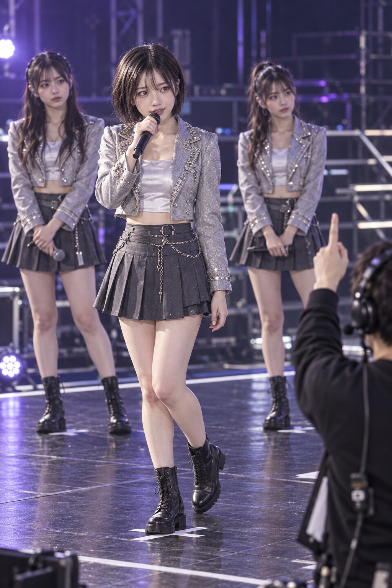
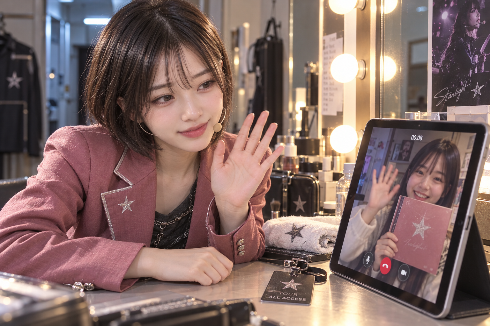
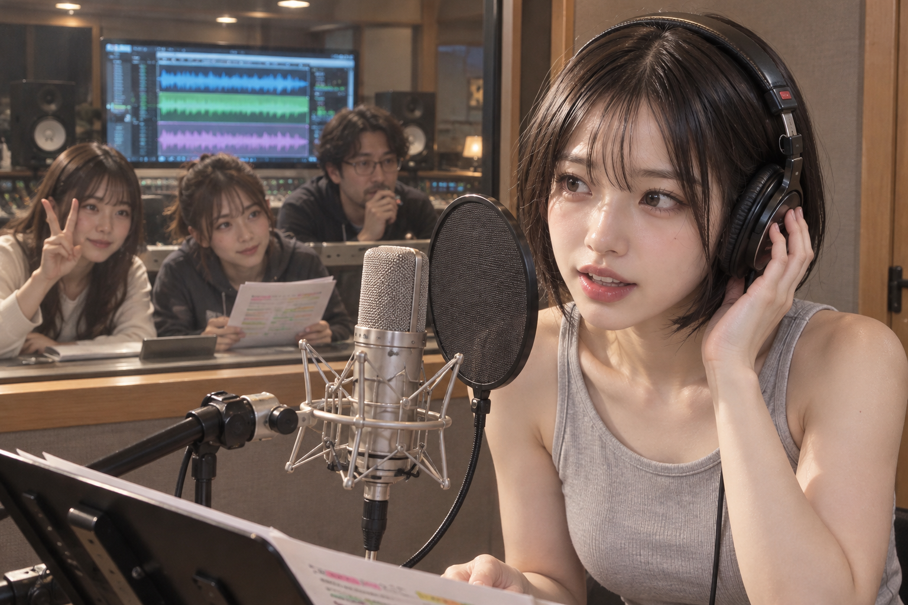

# 아이돌물: 세 독립 이미지 실험 결과

2026-10-23 KST. 데이터 등록·검증된 설치 버전 적용 후, 독립 서브에이전트3개가 서로 다른 랜덤 콘셉트를 정하고 첨부 사진으로 각각 프롬프트를 작성해 native 이미지를1회씩 생성했다. **세 이미지 모두 주제 단서는 읽히지만, 사전에 정한 세부 장면의 엄격한 전체 통과는0/3이다. 신규 후보의 실제 채택도0이므로 신규 데이터가 이미지 품질을 개선했다는 증거는 확보하지 못했다.**

데이터 반영·검색 결과는 [INTEGRATION-RESULTS.md](INTEGRATION-RESULTS.md)를 참조한다.

## 실험 설계와 실제 실행

세 에이전트는 대화 이력을 전달받지 않는 독립 문맥으로 시작했다. 코디네이터가 공연/라이브, 팬 상호작용, 제작 현장이라는 넓은 다양성 범위만 나누고, 세부 장면은 각자가 OS 난수로 선택했다. 이 범위나 세부 연출을 사용자 필수 조건으로 바꾸지 않았다.

각자는 최신 working SKILL과 허용된 중립 precore 자료를 읽고, 후보·리서치·다른 arm을 보기 전에 baseline/core/관찰 기준을 확정했다. 이후 동일한 새 설치 generation을 명시적으로 고정해 검색·원문 검토·대안 비교·구성 감사를 실행했다. 구성 감사의 실패는0이었으나, 후보 없이 authored evidence로 요청 의미를 보존했다는 uncovered_intent 경고가 A4개/B5개/C4개 있었다. 기술 감사 PASS는 이미지 PASS가 아니다.

```text
generation: 1d1802f68050e7c3034b0a4f55d3d3221575e81e343ee1433f2229225878d138
native generation: a96224b17d1d894276583b0602462e39b3cde4bb80be8a35e0f2c58a956c894d
installed code SHA: ec29f441dbfc26930e7f4fb71ced759bf5ae271e672176110b21d2a7f6c846ef
```

테스트 후 기본 버전은 동시 작업으로 한 번 더 갱신됐다. 새 기본 버전에서도 이번165개 source/219개 binding이 그대로 보존됨을 확인했다. 위 버전은 세 실험의 실제 고정 버전이며, 후기 기본 버전으로 결과를 소급 변경하지 않았다.

공통 참조는 사용자가 첨부한 `/Users/chasoik/Downloads/0CB25F47-BB90-4DBD-8993-733BA8282851(20260927-041323).jpeg`다. 이미지의 얼굴·헤어 외형만 참고했으며 실제 신원·나이·이력은 추론하지 않았다. 24세 설정은 각자가 만든 허구 설정이다. 실제 파일 경로·해시를 native transport에 연결했고, 각자의 실제 생성 호출은1회씩이다. 외부 CLI/API 대체 호출이나 실패를 덮는 추가 이미지 호출은 하지 않았다.

코디네이터의 최종 무결성 감사는 각 arm12개·합계36개 점검을 통과했다. 동일 최신 SKILL 해시, 고정 generation, coordinator envelope 불변, `h-f2-v2`, 실제1회 호출, 참조 원본 해시, 저장 PNG 해시, 실제 prompt 해시, 사전 baseline 보존과 후보 미채택을 확인한 **기록·전달 감사**다. 픽셀 성공률을 뜻하지 않는다. [무결성 감사 JSON](image-test-evidence/coordinator-final-integrity-audit.json)에 원본 이미지3개의 해시·크기·ledger ID가 있다.

통제값은 저장된 기본값 sensual1/fetish0/creativity1/surreal0을 유지했다. 실제 픽셀은 옷을 입은 인물의 얼굴·집중·작업 관계가 중심이며, 별도 페티시 사물 강조나 초현실적 변형이 없다. 이 정성 관찰은 사용자 선호나 만족도 판정이 아니다.

| arm | 독립 랜덤 장면 | 신규 노출 CID/occurrence | 신규 실제 채택 | 엄격 전체 결과 |
|---|---|---:|---:|---|
| A | 음악방송 리허설의 재시작 큐 | 6/9 | 0 | 미통과 |
| B | 팬 영상통화 종료 직전의 답례 인사 | 3/6 | 0 | 미통과 |
| C | 녹음실 하모니 픽업과 유리 너머 멤버 큐 | 2/2 | 0 | 미통과 |

각 arm의 전체 노출은32 occurrences이며 distinct source 수는27/27/30이다. 새 source는 합계11개·17 occurrences다. 각자가 모든 occurrence와 완전한 원문 대안을 검토한 뒤 baseline을 선택했다. 코디네이터도 최종 프롬프트가 후보 접근 전에 확정된 baseline과 외곽 공백을 제외하고 동일함을 확인했다. 선택된 native 후보·보존한 material inspiration도 모두0이다. 노출을 채택이나 인과적 기여로 계산하지 않았다.

## A — 음악방송 리허설

난수 seed `9522969309174889366`, 독립 작성 네 방향 중 index2. 세 멤버가 바닥 마크에 서고, 리드가 마이크를 든 채 플로어 매니저의 한 손가락 큐를 보는 장면이다.



주제·참조 외형·위계는 지지된다. 세 멤버의 통일된 의상, 마이크, 바닥 X, headset crew의 지시가 함께 보이고 주인공은 발끝까지 남는다. 그러나 리드의 눈길이 그 큐 손에 확실히 이어지는지는 불명확하다. 뒤 부츠 전체가 떠 있어 사전에 요구한 가벼운 heel-lift와도 차이가 있다. 이는 해부학적 기괴함을 주장하는 평가가 아니라 특정 장면의 자세·연결 재현 실패다.

| 사전 기준 | 코디네이터 최종 | 근거 |
|---|---|---|
| A1 작업 현장 | PASS | 그룹·마이크·마크·crew 동시 가시 |
| A2 큐와 주의의 연결 | UNOBSERVABLE | 손은 보이지만 정확한 시선 끝점 불명확 |
| A3 참조 외형 | PASS | 단발·가느다란 앞머리·주요 얼굴 비례 관찰 가능 |
| A4 신체·접촉·자세 | FAIL | 지지발/X는 있으나 뒤 발 전체 lift |
| A5 사진 위계 | PASS | 전신 주인공·후방 멤버·큐 손 가독성 유지 |

독립 작성자는 A2/A4를 FAIL로 기록했다. 코디네이터는 A2를 UNOBSERVABLE로 분류하지만 둘 다 전체 통과를 인정하지 않는다. 초기 코디네이터의 관대한 A2/A4 PASS와 사용자에게 전달한1/3 통과 안내는 정정했다. 최초 판정 파일과 수정 근거를 모두 남겼다.

[최종 프롬프트](image-test-evidence/arm-a/final-prompt.txt) · [사전 기준](image-test-evidence/arm-a/pixel-criteria.frozen.json) · [코디네이터 판정](image-test-evidence/coordinator-pixel-review-arm-a.json)

## B — 팬 영상통화

OS 난수 hex `11471ebf7620ab5948cd1d959ff899922e6cc40c0a5fc12e4675b99f355123ce`. 독립 encounter pool에서 투어 대기실 영상통화, 순간 pool에서 안심시키는 작별 인사를 선택했다. 나머지 연출은 저자의 허구 설정이며 모든 난수 후보를 최종 장면에 강제 적용한 것은 아니다.



대기실·무대 재킷·귀 마이크·공통 별 문양·투어 패스와 앨범이 연결되고, 태블릿 경계 안의 팬과 실제 방의 퍼포머가 각각 손을 흔든다. 얼굴·헤어 참고도 잘 읽힌다. `00:08` 표시까지 보인다. 다만 viewer-left의 가까운 어깨에서 이어진 해부학적 오른팔이 테이블에 놓이고, 왼팔이 wave한다. 요청한 왼팔 지지/오른팔 wave와 반대다.

| 사전 기준 | 최종 |
|---|---|
| idol_context, fan_call, reciprocal_farewell, screen_relation | PASS |
| end_timing, reference_appearance, visual_direction | PASS |
| embodiment | FAIL — 어깨에서 손까지 추적하면 좌우 반전 |

초기 독립 작성자는 일반적인 소유·접촉만 확인해8 PASS로 기록했다. 코디네이터의 어깨→팔꿈치→손 경로 지적을 재검토한 뒤, 최초 기록을 보존하고7 PASS/1 FAIL로 수정했다. 손의 형태 자체가 기괴하다는 뜻은 아니다. `00:08`은 정해 둔 숫자 표시 기준을 충족하지만 남은 시간/경과 시간이나 실제 작별의 시간 순서를 입증하지 않는다.

[최종 프롬프트](image-test-evidence/arm-b/final-prompt.txt) · [사전 기준](image-test-evidence/arm-b/prepixel-criteria.json) · [좌우 보충 검토](image-test-evidence/arm-b/laterality-supplement.json) · [코디네이터 판정](image-test-evidence/coordinator-pixel-review-arm-b.json)

## C — 녹음실 하모니 픽업

OS 난수 seed `eab5f29432208fcb73eac22df3fc0a08`. 주인공이 earcup을 잡고 pop filter 앞에서 노래하며, 유리 너머 멤버가 두 손가락으로 진입 큐를 보내고 프로듀서가 토크백 버튼을 누르는 장면이다.



주인공 외형, 헤드폰 접촉, 열린 입, 마이크·pop filter, 두 멤버, 공통 색 표시 가사지와 세 색 waveform lane이 보여 그룹 녹음 맥락은 잘 읽힌다. 그러나 두 손가락은 V 포즈로도 읽히며 주인공 시선이 그 손에 도달하는지 불명확하다. 프로듀서의 보이는 손은 턱·입 근처에 있고 토크백 버튼과의 접촉은 보이지 않는다.

| 사전 기준 | 코디네이터 최종 |
|---|---|
| C1 외형, C2 녹음 행위, C5 그룹 맥락, C6 신체 소유, C7 위계 | PASS |
| C3 멤버 큐·시선 연결 | UNOBSERVABLE |
| C4 프로듀서 토크백 접촉 | UNOBSERVABLE |

독립 작성자는 C4를 필수 접촉 누락에 따른 FAIL로, 코디네이터는 콘솔 끝점이 가려져 UNOBSERVABLE로 분류했다. 두 판정 모두 전체 통과를 인정하지 않는다. C3에 대한 초기 코디네이터의 개연성 PASS도 모호한 끝점을 수용할 수 없다는 재검토 후 UNOBSERVABLE로 수정했고 초기 기록을 보존했다. 화면의 waveform이나 열린 입으로 실제 음성·하모니·라이브 가창을 확정하지 않는다.

[최종 프롬프트](image-test-evidence/arm-c/final-prompt.txt) · [사전 기준](image-test-evidence/arm-c/pixel-criteria.frozen.json) · [코디네이터 판정](image-test-evidence/coordinator-pixel-review-arm-c.json)

## 해석과 다음 반영

사용자의 아이돌물 주제와 참조 외형이 세 이미지에 나타난 것은 관찰 가능하다. 반면 세 장면의 세부 관계를 모두 재현하지 못했고, 이번 신규 데이터는 검색에 노출된 후 최종 프롬프트에 쓰이지 않았다. 따라서 **등록·검색 성공, 이미지의 주제 가시성, 후보의 실제 사용, 정밀 장면 성공, 품질 개선을 각각 별도로 보고한다.**

다음 우선순위는 노출된11개 신규 source의 실제 native 의미/역할 자격 검토, 조합 가능한 완결 관계 단위 보강, 짧은 한국어 장르 질의의 발견성 개선이다. 구체 계획은 반영 결과 문서에 있다. 이 세 장면은 이제 알려진 회귀 사례이며 다시 독립 holdout으로 부르지 않는다. 단일 이미지3장·통제된 전후 이미지 부재·정성 평가라는 한계가 있고 사용자 선호 판단도 남아 있다.

모든 원문·난수·freeze·검색·source occurrence 처분·대안 비교·native 실행·recorder·평가 파일은 `image-test-evidence/`에 보존한다. 코디네이터 최초 판정과 수정 판정도 그 폴더의 별도 파일이다.

최종적으로 세 arm 모두 `h-f2-v2` recorder/manifest 검증과 `record_valid=true`를 확인했고 stale artifact는 없다. 세 managed pixel review의 `technical_qualification`은 모두 `fail`이다. 기록 형식이 유효하다는 사실과 이미지가 장면을 통과했다는 판정은 다르다.

- [A 독립 원보고서](image-test-evidence/arm-a/REPORT.md): 3 PASS/2 FAIL
- [B 수정 원보고서](image-test-evidence/arm-b/RESULTS.md): 7 PASS/1 FAIL
- [C 독립 원보고서](image-test-evidence/arm-c/REPORT.md): 5 PASS/1 FAIL/1 UNOBSERVABLE
