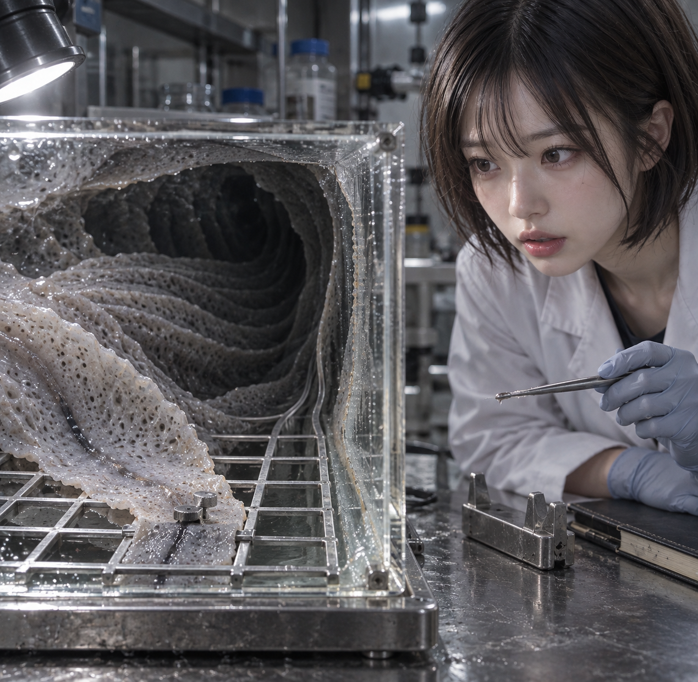
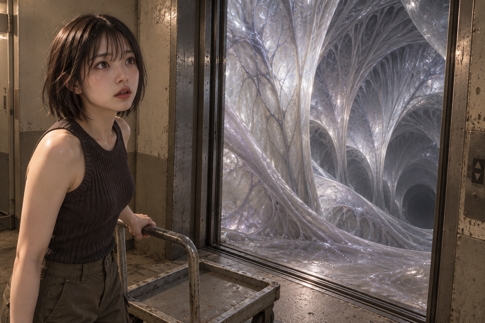

# 러브크래프트 공포 데이터 보강과 독립 재시험

## 변경 범위

기존 84개 연구 항목과 그 완성형 후보는 보존하고, 이미 장면에 설정된 대상 사이의 관계를 구체화하는 **시각 의미 카드 12개, 양언어 후보 12개, 역할 연결 41개**를 추가했다. 완성형 후보의 수량·구성 조건을 삭제해서 채택률을 높이지 않았다.

| 계열 | 추가한 관찰 가능한 관계 |
| --- | --- |
| 기록 A1–A4 | 유물과 기록의 능선·홈 대응, 기록 속 형상과 실제 표본의 경계, 두 기록의 공통 외곽과 국소 차이, 기록 이미지와 조사자 손의 분리 |
| 과학 S1–S4 | 감지구의 방향, 투명 용기와 내부 유기체 사이 틈, 케이블의 양쪽 연결 끝, 시료 내부의 깊이와 외부 테두리의 동시 관찰 |
| 조우 E1–E4 | 몸체에서 말단까지 이어지는 부속지, 작업 접촉과 관찰자 위치의 분리, 부착부와 겹친 주름의 구분, 건축 개구부와 접힌 몸체의 경계 |

모든 후보는 필요한 대상이 **독립적으로 설정된 경우에만** 전체 문장과 모든 끝점을 함께 적용한다. 없는 대상을 만들어 조건을 충족시키거나 어려운 절을 잘라 쓰는 것은 허용하지 않는다. 연구용 소유 관계 그래프와 인용은 native 승인이나 권한 증거가 아니다.

각 관계의 완성형 문장과 의미 카드는 [source-snapshot](source-snapshot/)에 있다. 원전은 모티프의 출처이며, 이 12개 국소 관계와 촬영 배치는 프로젝트에서 작성한 대안이다. 참고한 원전은 [The Call of Cthulhu](https://www.hplovecraft.com/writings/texts/fiction/cc.aspx), [The Whisperer in Darkness](https://www.hplovecraft.com/writings/texts/fiction/wid.aspx), [At the Mountains of Madness](https://www.hplovecraft.com/writings/texts/fiction/mm.aspx)다. 초자연적 효능, 의식, 역사적 진위나 적대 의도를 정지 이미지로 입증했다고 해석하지 않는다.

## 검색에서 발견하고 수정한 원인

이전 과학 사례의 실제 검색문에 있던 `senses a human observer does not possess`가 대상의 성질을 설명하는 절 대신 변경 금지 명령으로 분류됐다. `unmodeled_restricted_change`가 생기면서 **검색 이후 표시 단계에서 소품 후보 전체가 제거**됐다. 임베딩이나 순위 계산 자체가 실행되지 않은 문제가 아니었다.

인간에게 없는 감각을 설명하는 한정된 관계절만 명령 오분류에서 제외했다. 실제 금지 명령, 미지정 속성, 없는 신체 부위, source 조건과 typed witness 필터는 유지했다. 변경은 [query-scope.patch](query-scope.patch), 검증 범위는 [VALIDATION.json](VALIDATION.json)에 보존했다.

이전 실제 검색 14개의 정확한 문장과 검증된 벡터를 재사용해 새 전체 색인에서 진단했다. 문제가 있던 과학 소품 검색은 표시 가능한 후보가 0개에서 32개로 회복됐고, 여러 새 관계가 상위에 들어왔다. 해부학 연결과 접촉점 검색은 기존 증거가 있는 5개만 계속 표시했다. 새 후보의 순위가 높아도 이 필터는 완화하지 않았다.

이 재현의 32개는 **창의성 표본추출 이전의 표시 풀**이다. 이전 실제 발급 8개와 새 풀 32개를 채택률 상승으로 비교하지 않는다. 실제 새 실행에서 발급된 항목은 각 arm의 managed receipt로 따로 확인한다. 결과는 [QUERY-REPLAY.json](QUERY-REPLAY.json)에 있다.

## 실행 세대와 검증

- source 등록 검증: 새 후보 12개와 연결 41개, 기존 전역 source 19,801개와 기존 연결의 보존 확인.
- 독립 빌드: 안정된 설치 세대를 부모로 새 후보 12개를 추가하고 기존 문서 벡터 19,440개를 그대로 재사용했다. 이후 수정한 검색 분류 코드 한 파일만 새 코드 세대에 묶었다.
- 명시적으로 설치하고 시험한 H-F2 세대: `57e526a860aaaf3fa865e279e93dc873a1288f01cc89bed4dfbecb8ecf2df88f`.
- 그 native 세대: `8d8ecc2785498602e13bf48421c718d3d2ae97d9471d2368149f876c198db005`.
- 설치된 시험 세대: positive CID 19,450개, RID 19,452개. source·native index·H-F2 검증 통과. 전역 checkout의 다른 미완료 source 작업까지 이 시험에 포함했다고 주장하지 않는다.
- 변경 관련 회귀 테스트 94개 통과. 새 설치 코드에서도 감각 관계절 회귀 테스트 3개 통과.
- 이 작업의 설치는 `--no-activate`였고 CURRENT 쓰기는 0회다. 세 시험은 명시한 시험 세대만 사용했다. 종료 확인 시 공용 기본 설정이 다른 세대로 바뀐 동시 변동을 발견해 그대로 보존했다. HEAD는 시작 때와 같다. commit/push/merge는 이 재시험 작업에서 수행하지 않았다.

종료 시 관찰한 공용 기본 세대는 `ef02180fc06f390a079ecb7727ece11c2dd30e54394f9e1ae8b9112217bd29ac`다. 이 설정 변동의 작업 주체는 확인하지 않았다. 이번 시험 세대 `57e526…`와 그 source·코드·이미지 증거는 독립적으로 고정됐으며, 새 source 모듈과 검색 분류 코드는 시험한 사본과 계속 일치했다. 전체 세션 동안 공용 기본 설정이 불변이었다고 주장하지 않는다. 관찰 시점과 비교는 [PRESERVATION.json](PRESERVATION.json)에 있다.

## 시험 방법과 증거 범위

독립 서브에이전트 3개가 각 계열에서 서로 다른 무작위 컨셉을 선택하고, 후보를 보기 전에 기본 사진·요청 의미·잠금을 봉인했다. 첨부 인물 사진은 얼굴과 머리의 외형 가이드로 사용했으며 실제 신원을 추정하지 않았다. 이후 각 에이전트는 최초 검색에서 발급된 전체 source를 읽고 완성된 사진 대안을 비교했다. 새 후보를 채택해야 한다는 할당량이나 특정 CID 지시는 주지 않았다.

각 사례는 새 source의 발급, 기존 장면과 조건의 양립, baseline 대비 실제 prompt 문구 변화, 실제 이미지의 동시 관계 표현을 구분한다. H-F2 자료를 참고한 저작 기여와 typed native 자동 승인은 서로 다른 기록이다. 사용자 선호 판단은 미수신 상태로 남긴다. 세 사례는 전후 통제된 동일 장면 실험이 아니므로 이미지 품질의 인과적 향상이나 일반 성공률을 추정하지 않는다.

세 arm은 같은 코드·데이터 세대를 사용했지만 사진 컨셉과 설정 해석까지 동일한 통제군은 아니다. 모두 creativity 1, surreal 0, fetish 0이며 기록·조우 arm의 effective sensual은 1, 비인간 시료 중심으로 분류한 과학 arm은 0이다. 값을 맞추기 위해 봉인 후 설정을 바꾸지 않았다.

절차상 한계도 보존한다. 에이전트 위임이 요청 envelope 파일 제공보다 먼저 이뤄졌지만, 후보 자료를 제공하지 않았고 envelope를 받은 뒤 core를 봉인했다. 새 데이터 작성과 무작위 컨셉 생성도 완전한 이중맹검은 아니다. [authoring-provenance-note.json](authoring-provenance-note.json)에 기록했다.

기록 보존 arm의 최초 검색 시도는 `no personal identity`의 `no person` 부분 일치를 사람 제외로 오인하는 기존 파서에서 후보 검색 전에 막혔다. 원래 실행을 보존하고, baseline·잠금·설정·검색문은 유지한 채 authorial 메타문구 한 필드만 같은 뜻으로 정정해 새 실행에 재봉인했다. 이 복구를 이미지 동일 입력 재시도나 이미지 생성 횟수에 세지 않는다. 이 별도 부분 일치 문제를 이번 시험 세대의 수정 코드에 포함했다고 주장하지 않는다.

`prepare-slot-intents`와 `seal-slot-intents`는 세대 지정 인자를 지원하지 않아, 검증된 sealed entrypoint에서 중립 준비를 수행하고 첫 실제 `retrieve`에서 store와 위 세대를 명시했다. 인자 오류로 종료된 준비 명령은 검색이나 이미지 호출이 아니다.

## 이전 보고서 정정

이전 R41 `cand_44cbc2eb422f51dca0ec9977e13b29b5`는 뇌 용기가 아니라 덮인 가상 성인 표본·노출된 팔·도해를 포함한 source다. 실제 효과에는 `subject`가 있지만 `count`는 없다. 이전 비교 보고서에서 R41의 `count`를 거절 이유로 든 설명은 부정확했다. 실제 source 및 subject 변경 충돌을 기준으로 판단해야 한다. 원래 보고서와 생성 증거는 수정하지 않고 이 정정 기록을 추가했다.

## 실제 이미지 결과

실제 내장 이미지 생성은 각 arm 1회씩 **총 3회**, 반환 이미지는 **3장**, 재시도는 **0회**다. 새 후보는 두 arm에서 실제 발급됐고, 그중 과학 arm의 S4 한 개가 프롬프트에 구체적인 문구 변화를 만들었다. 기존 SCP 계열 I04의 받침·틈 관계는 별도의 기존 source 기여이며 새 러브크래프트 후보 수에 합치지 않는다.

| 컨셉 | 새 관계 후보의 실제 경로 | 직접 본 이미지의 결과 |
| --- | --- | --- |
| 유리 건판 복원과 거대 해안 구조 | A2 발급, 실제 표본 대상이 없어 전체 거절. 이전 R41도 전제·subject 변경 충돌로 거절. 새 데이터 문구 기여 0 | 유리 건판, 걷어내는 종이, 작은 등대와 거대 벽의 규모 대비는 명확하다. 개구부는 규칙적인 아치로 완화됐고, 먼 손의 연결부 및 단일 coating flow의 판별에는 한계가 있다. |
| 시료 내부의 불가능한 깊이 | S4 발급·기존 대상 확인·최종 문구 추가. cell의 바깥 테두리와 시료 자체 경계의 구분을 구체화했다. source SHA와 baseline/final literal을 독립 대조했다. | 깊어지는 주름, 격자 받침, 용기 벽과 시료 사이 틈이 보인다. 왼쪽 용기 경계가 잘려 전체 유한한 테두리와 내부 깊이의 동시 비교는 **부분 반영**이다. |
| 화물 엘리베이터 문 너머의 생체 공간 | 새 후보 발급 0, source 기여 0. source-free baseline을 그대로 생성 | 멈춘 카트·관찰자와 생체 막의 깊이는 보인다. 문틀 상단이 잘려 전체 개구부 높이와 생체 구조 크기의 비교는 불완전하다. 새 데이터의 기여로 계산하지 않는다. |

세 장 모두 root가 원본을 직접 연 뒤 최종 프롬프트와 source trace를 대조했다. root는 컨셉과 데이터 설계를 알고 있었으므로 맹검 평가라고 부르지 않는다. 각각의 [ROOT-REVIEW-archive.json](ROOT-REVIEW-archive.json), [ROOT-REVIEW-science.json](ROOT-REVIEW-science.json), [ROOT-REVIEW-encounter.json](ROOT-REVIEW-encounter.json)에 이미지 해시와 판단 근거를 보존했다. 이미지의 기술적 생성 성공과 엄격한 완성형 의미 통과는 구분하며, 이번 세 장에서 **전체 관계를 완전히 통과했다고 판정한 사례는 없다**.

세 arm의 공식 픽셀 검토 기록은 모두 유효하며 기술 판정은 모두 FAIL이다. 기록 arm은 5개 embodiment gate 중 2개 PASS·3개 partial FAIL(먼 손의 소유·관절 연결·가시성), 과학·조우 arm은 각각 4개 PASS·1개 partial FAIL(가시성·투영)이다. root가 국소 지지·틈을 확인한 사실은 과학 source 전체 경계의 잘림을 상쇄하지 않는다.

실행 요약, 원문 프롬프트, source별 전체 검토와 픽셀 감사는 [arms/archive/run-summary.md](arms/archive/run-summary.md), [arms/science/run-report.md](arms/science/run-report.md), [arms/encounter/run-summary.md](arms/encounter/run-summary.md)에 연결했다. [RESULTS.json](RESULTS.json)은 실제 source 발급과 authoritative 원장 ID를 정규화한 집계다. [EVIDENCE-COPIES.json](EVIDENCE-COPIES.json)은 각 복사본의 원본 위치와 바이트 해시를 보존한다.

기록 복구는 이미지 재시도와 구분했다. 과학 arm의 working bridge가 다른 기본 코드 환경의 recorder를 import해 기록을 거절한 뒤, 정확히 봉인된 `native-result`로 이미 반환된 이미지만 재연결했다. 조우 arm은 최초 기록의 잘못 입력한 skill SHA를 보존하고 공식 recorder로 metadata를 정정했다. 이 arm의 authoritative 원장은 `ledger-corrected.ndjson`, row ID는 `6bf5501fe06255d3`이며 기존 기록은 superseded다. 두 기록을 두 번의 이미지 호출로 세지 않는다. 이번 시험에서 moderation이나 transient HTTP 실패에 대한 이미지 동일 입력 재시도는 발생하지 않았다.

## 남은 보강 방향

이번에는 데이터 등록과 검색 표시의 단절을 고쳤고, 새 source 한 개가 실제 문구를 거쳐 이미지의 일부 관계에 반영되는 경로까지 확인했다. 아직 세 컨셉 전반에 새 source가 자연스럽게 기여한다거나 완성형 이미지 성공률이 올라갔다고 주장할 수 없다.

다음 우선순위는 동의어 추가보다 다음 세 가지다. 첫째, 새 해부·접촉 관계가 높은 순위에도 typed witness 단계에서 보류되는 경우에는 실제 전체 source의 증거와 native 의미 검토를 보강해야 한다. 둘째, 이미 있는 매체 하나만으로 성립하는 기록 관계와 공간 관계의 범위를 더 다양하게 만들되, 별도 표본이나 다른 기록이 필요한 후보의 전제를 줄여 쓰지 않는다. 셋째, 전체 테두리·양 끝점·신체 연결부가 필요한 사진에서는 멀리서 전체 경계를 보여주는 구도와 세부를 보여주는 구도를 생성 전에 완성된 대안으로 비교해야 한다. 이번 잘림을 가림 PASS나 자동 재생성으로 처리하지 않았다.
