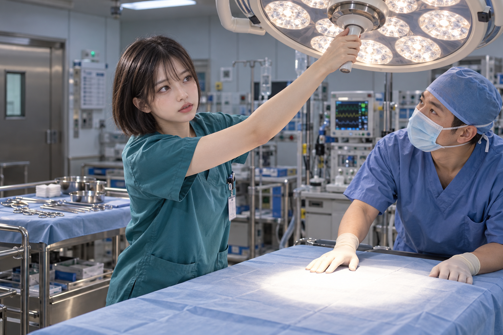
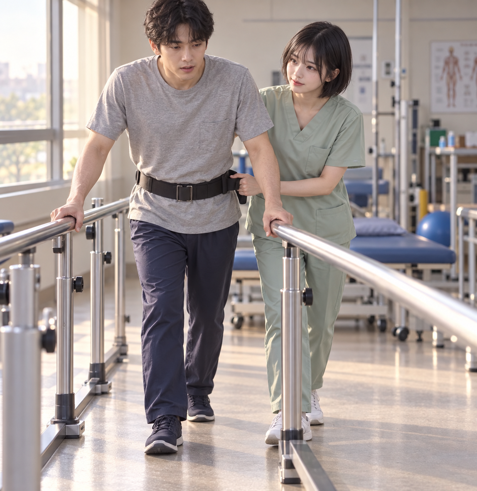
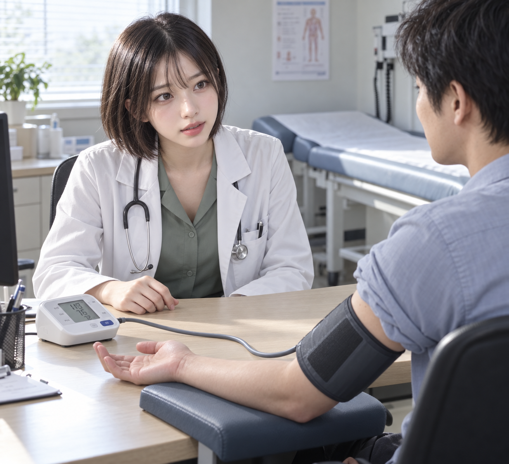

# 의학물 데이터 반영 및 독립 이미지 테스트

의학물 연구를 시각 의미 데이터와 실제 후보 소스에 반영했다. 세 독립 에이전트가
참조 이미지를 사용해 각각 1회 생성했고, 원본 픽셀과 모든 실행 기록을 검토했다.
의학 주제·참조 외모는 3/3에서 읽히며, 전체 필수 관계는 1/3 통과다.

| 반영 항목 | 결과 |
| --- | --- |
| 시각 의미 카드 | 172개 |
| 기존 원문 키워드 경로 | 346개, 모두 선택적·비자동 활성화 |
| 신규 완전한 한영 시각 후보 | 99개 |
| 신규 문맥·보류 진단 기록 | 51개, 시각 후보 검색에서 제외 |
| 기존 완전한 후보 재사용 | 22개, 원본 본문·조건·효과 변경 없음 |
| 신규 선택적 연결 | 198개 |

문맥 42개와 자료 보강 보류 8개에 더해, 거의 겹치지만 전체 의미가 다른 연출 세트
G06은 별도 유용성 검토를 위해 보류했다. G06을 다른 기존 후보와 동의어로 합치지 않았다.
연구의 100개 신규 초안 중 실제 양성 검색에 등록한 것은 99개다.

## 반영 위치와 의미

- `skills/photo-prompt-image-generator/assets/photo_medical_drama_semantics_20261023.json`
- `skills/photo-prompt-image-generator/assets/photo_candidate_medical_drama_20261023.json`
- `skills/photo-prompt-image-generator/assets/photo_candidate_medical_drama_bindings_20261023.json`
- `skills/photo-prompt-image-generator/references/medical-drama-semantics.md`

공간·의복·자세·기구·접촉·의료 영상의 소유자를 구별한다. 팔과 커프, 커프와 호스,
호스와 모니터, 손과 보조벨트, 발과 바닥처럼 끝점과 지지를 명시했다. 진단·자격·동의·통증·
의식·치료 성공·시간 경과는 사진에서 증명되는 사실로 취급하지 않는다. 자료의 정의·혼동
경계와 저자가 설계한 장면 기하도 구분했다. 키워드 경로는 한 구성 요소로 복합 용어 전체를
정의하지 않으며, 후보의 조건이나 고정된 사용자 의미를 우회하는 근거가 되지 않는다.

## 검증과 실행 버전

원본 후보·연결·카탈로그·정책 보존을 포함한 12개 검사가 모두 통과했다.
작업 데이터 사전 검사는 후보 21,681개, 연결 16,627개에서 오류 0개였다.
작업 검색 인덱스는 양성 후보 20,708개를 포함하며 기존 벡터 20,609개를 재사용하고
신규 99개를 정확한 현재 소스에서 로컬 생성했다. `provider_calls` 99는 로컬
EmbeddingGemma 실행 수이며 원격 유료 임베딩 호출 수가 아니다.

기존에 설치된 실행 버전의 모든 원본 후보·벡터·커널을 보존하는 데이터 추가 버전을
별도로 구성하고 배포 구현의 실제 검증을 통과시켰다. 이미지 테스트는 이 고정 버전을
사용한다. 실행 풀은 양성 CID 20,487개, 실현 문서 20,489개다. 작업 소스의 다른 미설치
동시 작업을 이 테스트가 검증한 것으로 취급하지 않는다. 새 150개 소스의 완전한 본문이
작업 소스와 일치하고, 양성 99개 전부의 노출 및 진단 51개 전부의 제외를 확인했다.
기본 실행 버전도 이 버전으로 전환했다. 후보의 `native_approval`은 모두 false로 유지한다.

- H-F2 generation: `1d3013b5e422e72eb80bdd75189ebe25575ffa92aecc3378ed8ba79358b897bd`
- Native generation: `3822da02620925b099e8917fbd82a97840456a5ed79f3d38a4ea4b5a69c2153f`
- 증거: `integration-evidence/integration-summary.json`

인덱스 검증 뒤 다른 작업의 espionage_full 소스 모듈 2개가 추가된 것도 관찰했다.
이 추가는 보존했으며 앞선 작업 인덱스 검증을 그 이후 소스 합집합의 검증으로
소급하지 않는다. 세 이미지의 소스와 검색은 명시한 설치 버전으로 고정돼 있다.
별도 기록은 `integration-evidence/concurrent-source-drift.json`이다.

첫 실행의 공용 소스 잠금과 기존 인덱스 불일치는 다른 인덱스 작성 작업이 끝날 때까지
보존했다. 타 작성자의 잠금을 지우지 않았다. 그 뒤 반영·재구축·사전 검증을 마쳤으며
초기 실패 기록도 남겼다. 기존 연구 시점의 검증 결과를 소급해서 성공으로 고치지 않았다.

## 독립 이미지 테스트

세 에이전트는 원문 요청과 첨부 이미지, 중립적인 스킬 절차만 전달받고 서로의 장면·
프롬프트·결과를 보지 않은 상태에서 기본 장면과 판정 기준을 먼저 고정했다. 각자 별도
요청 봉투, 코어, 의도 계획, 검색 샘플, 최종 감사, 이미지 호출 및 기록을 사용한다.
수술실 준비, 재활 보행, 외래 혈압 재확인을 서로 다른 전체 장면으로 선택했다.
각 에이전트는 실제 반환된 후보를 검토하고, 채택한 후보의 전체 의미를 프롬프트에
운반했는지 별도로 기록한다. 참조 사진은 외모 안내로만 사용하며 실제 직업이나 나이를
확정하는 근거로 사용하지 않는다.

결과: 완료. 기본 제공 `image_gen` 도구를 팔마다 1회, 총 3회 호출했다.
원본 3장을 저장했으며 재생성·대체 제공자는 없다. 관측된 이미지 모델명은 제공되지
않았으므로 특정 모델명으로 추정하지 않았다. 세 팔의 구성·런타임·리뷰 기록 감사는
통과했다. 모든 팔에 남은 4개 intent coverage 경고는 비차단 작성 근거 경고로 보존했다.
관리형 기술적 픽셀 충족은 A PASS, B/C FAIL이다.
판정은 의료 주제 인식, 참조 외모, 새 후보의 채택과 실제 픽셀, 전체 장면 완성도,
사용자 판단을 구분한다. 필수 관계 일부가 가려지거나 불완전하면 전체 통과로 처리하지
않는다. 차단된 출력은 `BLOCKED_UNSCORED`이며 픽셀 실패 점수를 만들지 않는다.

연구에서 작성한 개발용 60개 회귀 사례는 이 세 독립 이미지 테스트와 구분된다.
이번 반영은 그 전체 120개 한영 검색 질의의 전수 실행이나 독립 홀드아웃 평가를
완료했다는 뜻이 아니다. 단일 이미지 세 건으로 이전 버전 대비 품질 향상의 인과를
입증하지 않는다. 커밋·푸시는 수행하지 않았다.

## 생성 결과와 픽셀 판정

| 팔 | 독립 콘셉트 | 새 후보 노출 / 사용 | 원래 테스트 | 전체 판정 |
| --- | --- | --- | --- | --- |
| A | 다음 환자 전 수술등을 맞추는 두 의료진 | 5 / 0 | 5/5 | PASS; 기존 R01 수술등·수술대·별도 기구대 3/3 |
| B | 평행봉과 보조벨트로 지지하는 재활 보행 | 8 / 1 (A09) | 4/5 | FAIL; 왼발 대신 오른발이 앞, 치료사 통로 안쪽 위치 일부 불명확 |
| C | 외래 혈압 측정과 마주 보는 진료 | 4 / 2 (D06, A01) | 4/5 | FAIL; 펼친 손 대신 말린 손, 책상 열린 끝의 배치 가림 |

새 후보의 완전한 관계는 D06의 커프–호스–모니터 연결에서 확인했다. B의 A09와 C의
A01은 일부 관계가 읽혀도 전체 소스 충족은 실패다. A의 성공은 기존 후보 R01을 활용한
성공이며 신규 데이터의 픽셀 재현 성공으로 세지 않는다. 따라서 새 후보를 쓴 두 팔 중
그 후보들의 모든 관계를 함께 통과한 팔은 없다. 원본 이미지 세 장의 전체 주제는
명확하며, 이는 모든 세부 관계가 충족됐다는 판정과 구분된다.

조정자가 원본 세 장을 직접 보고 팔별 관찰을 대조했다. A의 동료 손끝은 빛 영역
위쪽 경계와 겹치므로 손 전체가 빛 영역 밖에 있다는 주장은 하지 않는다. C의 첫 인상에서
A01을 통과로 보았던 관찰은 실제 책상 끝 경계를 다시 추적한 뒤 partial/fail로 정정했고,
`image-test-evidence/c/observation-correction.json`에 전후 관찰을 보존했다.

참조 외모 비교는 얼굴·눈·앞머리·짧은 보브의 정성적 유사성 관찰이다. 실제 인물의
동일성·나이·직업이나 치료의 적절성·성공을 판정하지 않는다. 사용자 수락은 세 장 모두
pending이다. 실패 결과도 원본 그대로 보존했고 추가 생성하지 않았다.

### 결과 파일

- 전체 정확한 프롬프트: `PROMPTS.md`
- 조정자 집계·이미지 해시·원장 검사: `integration-evidence/independent-image-results.json`
- A: `image-test-evidence/a/result-summary.json`, `pixel-test-review.json`
- B: `image-test-evidence/b/result-report.md`, `pixel-review.json`
- C: `image-test-evidence/c/result-report.md`, `pixel-review.json`

각 팔의 `run_manifest.json`과 `image_runs.ndjson`에서 1개 시도, 실제 이미지 해시,
원래 코어·의도 잠금·참조 해시, 스킬 스냅샷과 같은 고정 검색 버전을 확인했다.
서로 다른 에이전트/팔별 폴더를 사용했으며 별도 Git worktree 세 개를 만들었다는 뜻은
아니다. 생성·기록 성공 상태와 픽셀 충족 판정도 구분한다.

작업 도중 기본 실행 버전은 다른 병행 반영을 포함한
`d63b465fe1471d65ffdf0765b2d67dcc4b9d88b85202866093100f1564aa2240`으로 갱신됐다.
이 최신 기본 버전에서도 신규 양성 후보 99개 전부가 존재하며 신규 150개 전체 본문이
이번 작업 소스와 완전히 같음을 재확인했다. 이미지 테스트는 최초에 명시한
`1d3013b5e422e72eb80bdd75189ebe25575ffa92aecc3378ed8ba79358b897bd`에 그대로 고정했다.
검사 근거는 `integration-evidence/current-default-medical-exposure.json`이다.

## 관찰에서 도출한 다음 개선 대상

1. 수술등 조절 손잡이–손–팔–조명 대상의 완전한 신규 후보가 실제로 유용한지 별도
   소스/중복 검토를 한다. 이번 A에서 새 후보를 선택한 것으로 소급하지 않는다.
2. 보행 통로 안쪽 위치는 두 발과 양 레일의 바닥 경계를 한 시점에 분리해 보이는
   배치로 개선한다. 좌우 발의 주체 기준 방향을 유지한다.
3. 진료실 후보의 책상 열린 끝은 경계가 가려지지 않는 전체 배치를 설계하고, 열린 손의
   손가락 상태를 함께 보이게 한다. 일반적인 맞은편 착석으로 정의를 약화하지 않는다.

위 항목은 이번 결과에 대한 다음 검토 대상이며, 현재 후보·프롬프트·이미지의 요구를
이미지에 맞추어 사후 변경한 것이 아니다. 새 리비전이나 재생성의 결과는 아직 없다.

수술실 준비

재활 보행

외래 혈압 측정

## 게시 및 정리 단계

이미지 표시 링크는 저장된 연구 증거 복사본으로 연결했다. 실행 원장의 실제 원본 경로·
해시와 당시 검증 기록은 보존한다. 이전 `SHA256SUMS`는 해당 연구/생성 단계의 스냅샷이다.
게시 단계의 파일 선택과 검증은 `publication-evidence/`에 별도로 기록한다.
