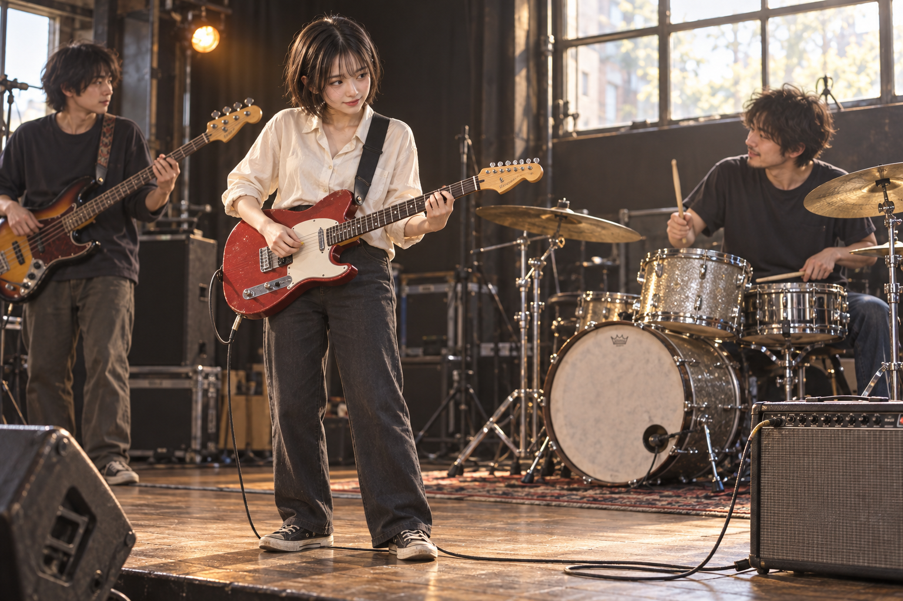
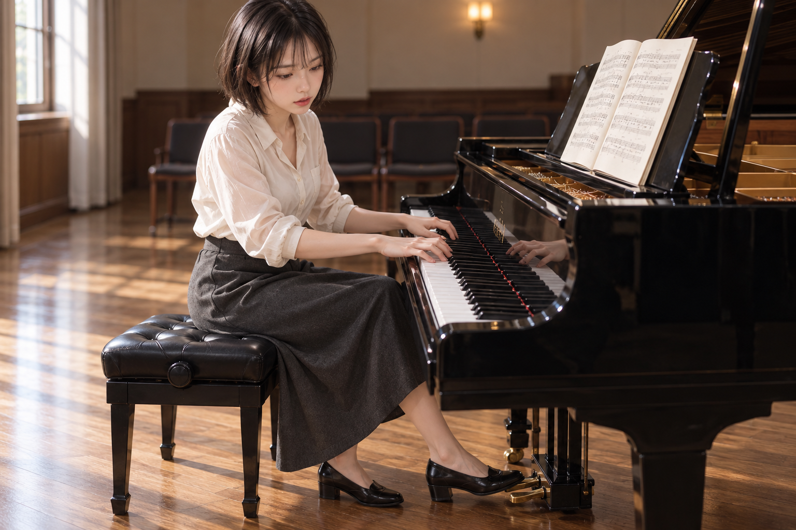
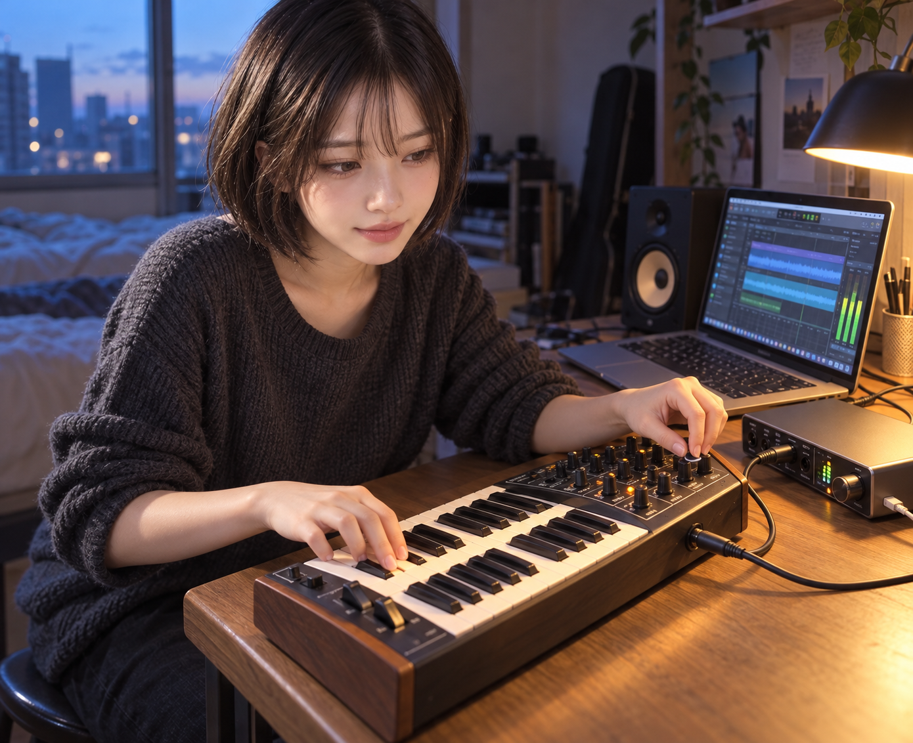

# 음악물 데이터 반영과 이미지 검증 결과

음악물·밴드물 시각 카드 124개를 데이터에 반영하고, 첨부 사진을 실제 참조로 전달해 독립 서브에이전트 세 곳에서 이미지를 각 한 장 생성했다. 음악 주제와 얼굴·머리 참고는 3/3 장면에 보였다. 사전에 확정한 모든 관계를 함께 보여야 하는 엄격 전체 장면 기준은 0/3 통과했다.

## 반영한 데이터

| 항목 | 반영 |
| --- | --- |
| 한영 시각 의미 카드 | 124개 |
| 새로운 완전한 선택형 시각 후보 | 122개 |
| 기존 완전한 원문 재사용 | 2개 |
| 문맥 구분과 연구 보류 진단 | 20개 + 12개 |
| 선택형 바인딩 | 370개 |
| 원문 키워드 추적 | 392행 |

악기·연주 손동작, 녹음과 공연 노동, 복식·머리, 관객, 합주와 이야기 소재를 포함했다. 손과 악기의 소유자, 지지, 접점, 케이블의 양 끝과 방향을 같은 명제 안에 보존했다. 팜 뮤트와 운지 손 뮤트, 슬랩과 팝, 크로스핸드와 오픈핸드, 어쿠스틱 크로스스틱과 전자 패드, MIDI 데이터와 오디오 파형을 서로 바꾸지 않는다. Punk/Funk, comping의 두 용법, conductor·wedge·turntable 등의 문맥 구분도 보존했다.

기존 IEM과 관객 마이크 원문은 오른쪽 귀·뒤 허리 수신기 및 전면 배리어 등의 전체 조건을 유지해 재사용했다. 나머지 122개를 새로운 선택형 원문으로 등록했다. 32개 진단은 긍정 검색 풀에서 제외한다. 새 자료는 모두 native_approval false이며, 연구 정의나 이번 이미지가 원문 전체의 native 자격을 부여하지 않는다.

실제 파일은 [시각 의미 데이터](../../../../skills/photo-prompt-image-generator/assets/photo_music_band_semantics_20261025.json), [후보](../../../../skills/photo-prompt-image-generator/assets/photo_candidate_music_band_20261025.json), [바인딩](../../../../skills/photo-prompt-image-generator/assets/photo_candidate_music_band_bindings_20261025.json)이다. [카드와 후보 매핑](integration-evidence/card-candidate-map.json)이 모든 카드의 등록·재사용·문맥 경로를 잇는다. [리서치](RESEARCH.md)와 [1차 출처](SOURCES.md)의 정의·문맥 근거는 저작한 장면 전체의 기하학을 입증하지 않는다.

## 데이터와 검색 검증

의미 경계 검증 17개와 후보 사전 검증을 통과했다. 작업 전 23,012개 후보와 17,968개 바인딩의 원문·조건·effects·정책은 유지됐다. 최종 작업 사전 23,596개에는 이번 154개 외에 동시 작업 추가분 430개가 포함된다. 이 숫자 전체를 이번 음악 추가량으로 세지 않는다.

새 자료가 포함된 전체 긍정 풀에서 한영 자연어 개발 질의 88개, 카드 문장 smoke 질의 248개, 일반 장면 대조 6개를 실제 실행했다.

| 검색 확인 | 결과 |
| --- | --- |
| 명시된 목표가 있는 자연어 질의 | 68개 |
| 목표 중 하나가 상위 8개 안에 노출 | 64/68 |
| 목표 중 하나가 상위 32개 안에 노출 | 66/68 |
| 모든 지정 목표가 상위 32개 안에 노출 | 63/68 |
| 카드 문장 목표가 상위 8개 안에 노출 | 248/248 |
| 일반 장면에서 새 음악 후보가 상위 10개 안에 노출 | 0/6 |

개발자가 작성한 질의와 카드 파생 smoke이므로 독립 holdout 정확도로 해석하지 않는다. 다중 목표의 일부와 두 영어 질의의 목표 순위가 남았다. 검색 규칙이나 원문을 이 질의에 맞추어 수정하지 않았다. [현재 버전 검색 결과](integration-evidence/retrieval-qualification.json), [남은 순위 사례](integration-evidence/retrieval-gaps.json), [원문 보존 검증](integration-evidence/source-preservation.final.json)을 보존했다.

동시 설치 변경을 발견해 기존 기본 버전을 덮어쓰지 않았다. 음악만 추가한 successor를 검증했고, 이후 실제 기본 버전에 동일한 음악 후보·바인딩이 포함된 것을 파일 해시와 전체 seal로 확인했다. 해당 기본 버전에서도 342질의를 재실행하고 로컬 runtime을 확인했다. [설치 검증](integration-evidence/active-release-validation.json)에 동시 수정된 다른 주제 원문 10건도 분리해 기록했다.

최초 검증 완료 당시 기본 H-F2는 d75d1546f9bdb3537d1316c0e14a5a04903fd29b1cedcfc63caefa328b690cd1이다. 이미지 세 팔은 공통으로 d881305d4e1cf5d0b2e0926c77ee65324b4c5d0088176be1bc3d2b4532424514에 고정했다. 두 버전의 음악 후보와 바인딩은 byte 단위로 같고, source kernel 코드는 같지만 전체 검색 모집단은 다르다. 이미지 결과를 다른 모집단의 재생성 결과로 표시하지 않는다.

## 독립 이미지 테스트

세 팔은 최신 SKILL과 허용된 중립 입력, 원 요청, 참고 사진만으로 무작위 콘셉트·초안·판정 기준을 먼저 동결했다. 서로의 콘셉트·프롬프트·결과를 공유하지 않았다. 한 팔당 실제 image_gen.imagegen 한 번, 총 3회이며 재시도와 추가 생성은 0회다. 첨부 사진은 텍스트 경로만 적은 것이 아니라 referenced_image_paths로 실제 전달됐고 부모 검토에서도 payload·참조 SHA·최종 프롬프트 일치를 확인했다. 사용 범위는 보이는 얼굴과 단발머리 참고다.

| 팔 | 무작위 콘셉트 | 새 음악 후보 노출 고유/등장 | 가시 판정점 통과 | 엄격 전체 |
| --- | --- | --- | --- | --- |
| A | 오후 작은 무대의 밴드 트리오 | 9 / 9 | 3/6 | 실패 |
| B | 리사이틀실의 피아노 리허설 | 2 / 4 | 6/8 | 실패 |
| C | 새벽 홈 스튜디오의 신시사이저 녹음 | 0 / 0 | 4/7 | 실패 |

각각 [A 프롬프트](image-test-evidence/a/prompt.txt)·[A 테스트케이스](image-test-evidence/a/testcase.json)·[A 픽셀 리뷰](image-test-evidence/a/pixel-review.json), [B 프롬프트](image-test-evidence/b/prompt.txt)·[B 테스트케이스](image-test-evidence/b/testcase.json)·[B 픽셀 리뷰](image-test-evidence/b/pixel-review.json), [C 프롬프트](image-test-evidence/c/prompt.txt)·[C 테스트케이스](image-test-evidence/c/testcase.json)·[C 픽셀 리뷰](image-test-evidence/c/pixel-review.json)를 보존했다.

A는 기타 양손 접촉, 삼인 합주와 상호 시선이 보였다. 기타에서 앰프까지 같은 케이블의 전 경로, 드러머의 의자 지지, 스틱과 스네어 헤드 접촉을 모두 확인하기 어려웠다.

B는 한 사람·양손·건반과 벤치 지지가 명확했다. 오른발이 먼쪽 페달과 일부 조립체를 가려, 정확한 오른쪽 페달 접점과 전체 구조가 함께 보이는 조건은 부분 관찰이었다. 가림만으로 해부학적 오류를 진단하지 않았다.

C는 얼굴, 건반·노브 조작과 DAW 파형 화면이 보였다. 실제 배우 기준 오른손이 건반, 왼손이 노브를 조작해 동결한 좌우 역할이 반전됐고, USB 경로와 끝점이 오른쪽 프레임 밖으로 나갔다.

부모도 세 원본을 직접 보고 같은 전체 실패 결론을 기록했다. 총 21개 중 13개 가시 판정점이 통과했지만, 각 장면의 모든 기준이 함께 충족돼야 하므로 이 합계를 전체 성공률로 바꾸지 않는다. [부모 픽셀 리뷰](integration-evidence/parent-pixel-review.json)와 각 팔의 독립 결과·ledger·manifest를 보존했다. 프롬프트·렌더 감사와 픽셀 리뷰 기록 감사는 통과했고, 세 장의 기술적 전체 판정은 실패다. compose의 authored-evidence 경고 A6/B4/C5는 최종 원문 증거로 요청 의미를 유지한 비차단 경고로 남겼다.

새 음악 자료의 최종 retained inspiration과 native 채택은 세 팔 모두 0이다. A와 B는 후보를 검토한 후 독립 초안을 유지했고, C에는 새 음악 자료가 표본으로 전달되지 않았으며 기존 일반 혼합광 자료만 참고했다. 주제 가시성 3/3은 관찰 결과이고, 새 데이터 때문에 좋아졌다는 인과적 증거는 없다. 사용자 수용은 pending이다.

### A 밴드 트리오

### B 피아노 리허설

### C 홈 스튜디오

## 다음 검증에서 유지할 기준

가려진 끝점을 성공으로 처리하거나, 좌우 역할이 바뀐 결과에 맞춰 명제를 바꾸지 않는다. 다음 장면 설계에서는 기타 케이블의 단일 경로와 드러머 지지, 피아노의 세 페달 조립체, 배우 기준 좌우 손과 USB 양 끝을 담을 시점을 우선 검토한다. 이 자료는 새 native 승인이 필요한 완전한 원문과 그림의 관찰 항목을 연결하는 후속 근거로 사용할 수 있다. 채택을 강제하거나 세 이미지의 실패를 숨기기 위한 추가 생성은 하지 않았다.

[전체 기계 판독 결과](integration-evidence/FINAL-RESULT.json), [동결한 3팔 프로토콜](integration-evidence/three-arm-protocol.frozen.json), [원본 이미지 해시](integration-evidence/parent-pixel-review.json), [현재 반영 안내](../../../../skills/photo-prompt-image-generator/references/music-band-semantics.md)를 함께 제공한다. 이미지는 native 반환 원본과 byte 단위로 동일하며 보정·재인코딩하지 않았다. 이 문서는 최초 실험 완료 시점의 기록이다. 이후 게시 절차는 [게시 기록](PUBLISHING.md)에 있다.
