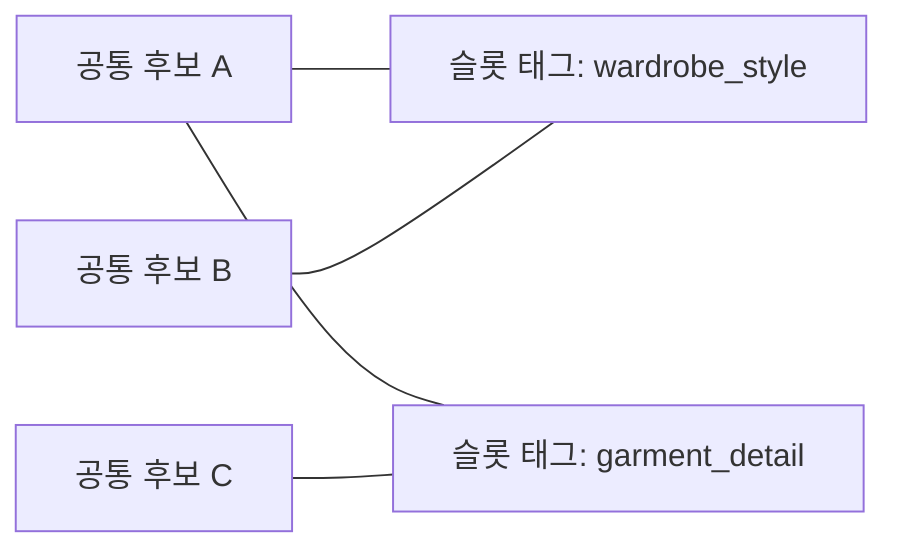
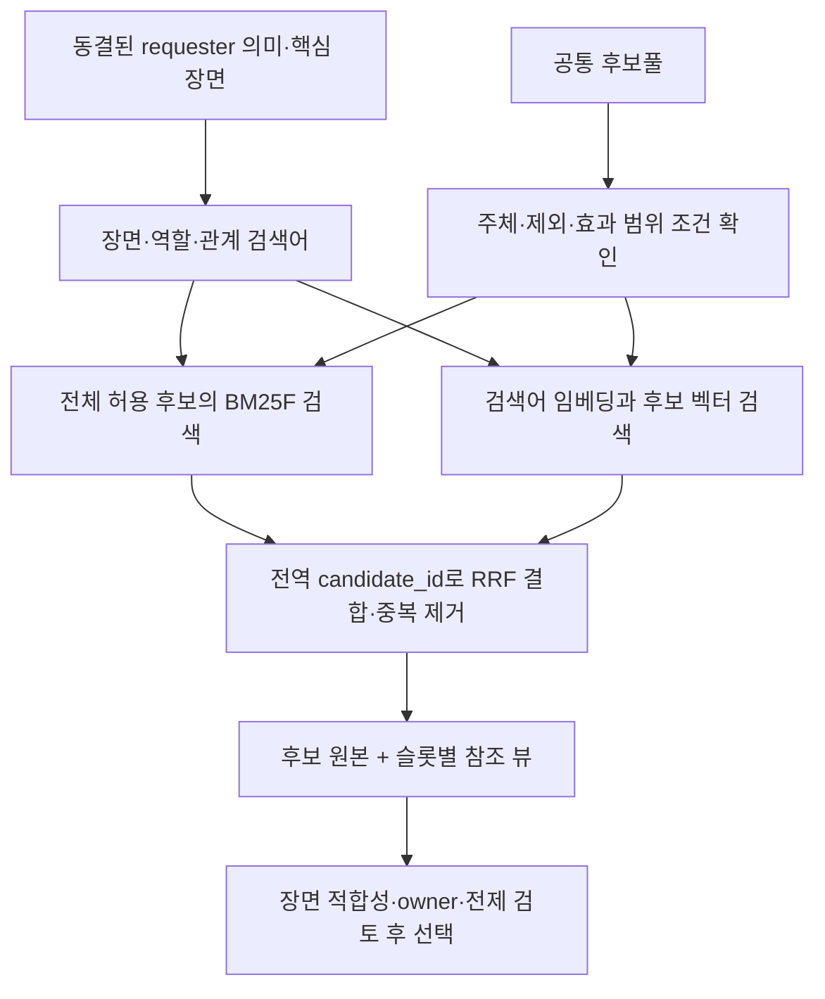

# 공통 후보 데이터풀·다대다 슬롯 연결·전역 하이브리드 검색 전환 계획

작성일·수정일: 2026-10-12, Asia/Seoul. 상태: 계획 작성 및 원본 구조 조사 완료, 구현 미착수. 사용자 추가 요구: 모든 운영 데이터·참조를 완전히 이관한 뒤 레거시를 제거하며, 레거시 호환성은 제공하지 않는다.

목표는 후보 원본을 슬롯에서 독립시키고, 하나의 후보가 여러 슬롯과 연결되도록 하며, 슬롯 소속으로 검색 대상을 잘라내지 않고 전체 후보에서 BM25F와 임베딩을 함께 사용해 찾는 것이다. 슬롯은 후보를 소유하는 상위 노드 대신 의미·용도·표현 역할을 설명하는 연결 정보로 사용한다.

이 문서는 앞선 슬롯 조회 개선 0–7단계 이후의 **새 전환 계획 1–9단계**다. 단계별 구현과 검증 결과를 저장하고 각 단계를 독립적으로 검토·커밋할 수 있도록 나눈다. **최종 완료는 신규 구조로 운영 데이터·참조·실행 경로를 100% 이관하고, 레거시 구조·코드·파일·인덱스·캐시·호환 경로를 제거한 뒤 재검증한 상태다.** 기본 검색 전환만으로 완료 처리하지 않는다. 현재 코드·후보 데이터·인덱스·runtime 포인터는 변경하지 않았다.

신규 런타임에는 v6/구버전 reader, adapter, 자동 변환, 구 ID resolver, dual-write, 레거시 fallback을 구현하지 않는다. 전환 전 baseline은 비교 증거로만 사용한다. 삭제 전 원본·대응표·SHA·Git 복구 지점을 운영 checkout 및 runtime store 밖의 별도 기록으로 보관할 수 있지만, 이를 제품의 호환 코드나 자동 로딩 대상으로 남기지 않는다. 과거 팩·receipt의 재생 지원은 범위에서 제외한다.

## 1. 현재 기준선과 문제

현재 작업 폴더를 직접 적재해 조사한 [BASELINE.json](/Users/chasoik/Projects/image-prompt/docs/research-evidence/photo-prompt/shared-candidate-pool-20261012/BASELINE.json)을 기준으로 한다. 이전 커밋의 clean 데이터와 현재 dirty 데이터를 섞어서 집계하지 않았다.

| 항목 | 현재 관측 |
|---|---|
| HEAD | `e7a694b10fb502b7991e5bdcbe15c361f2ffc800` |
| 기존 tracked dirty 파일 | 22개 |
| 관측한 활성 generation | `9bd8d853f65acb3263a579d15ef6a0e6606c73eeae740a522975cc6f84a3fc52`, revision 87 |
| 일반 슬롯·후보 레코드 | 112개 슬롯, 12,020행 |
| 슬롯을 제외한 기존 ID 종류 | 11,935개 |
| 여러 슬롯에 등장하는 동일 ID | 84개 그룹 |
| 동일 ID이고 레코드 내용까지 같은 그룹 | 16개 |
| 동일 ID이지만 레코드 내용이 다른 그룹 | 68개 |
| 기존 semantic index | 12,056문서: 슬롯 12,020 + 관계 개념·confounder·mechanism 36 |
| 기존 visual-profile index | 3,834문서 |
| 임베딩 공간 | 두 인덱스 모두 `gemini-embedding-2`, 768차원; text recipe는 서로 다름 |

16개 그룹의 동일성은 현재 로딩된 레코드의 JSON payload를 비교한 결과다. 슬롯에서 상속하는 효과·적용 조건까지 같은지는 아직 판정하지 않았다. 따라서 16개를 즉시 병합하거나, 68개를 모두 다른 의미로 단정하지 않는다. 서로 다른 ID의 의미상 중복도 후속 조사 대상이다. 최종 중복 제거 수를 먼저 정하지 않는다.

현재 일반 검색은 통합 BM25F 인덱스를 만들지만 조회할 때 `allowed_ids`를 해당 슬롯에 한정한다. 후보 식별자도 `slot:<slot>:<entry_id>`여서 슬롯 이동이 검색 식별자 변경으로 이어진다. 성인 표현에는 교차 슬롯 검색이 있지만, 공개 생성 경로는 검색어 임베딩 준비 함수를 호출하지 않아 기본 경로에서 keyword 조회가 실행된다.

주요 의존점은 [일반 검색](/Users/chasoik/Projects/image-prompt/skills/photo-prompt-image-generator/scripts/prompt_generator.py:10158), [검색 문서 구성](/Users/chasoik/Projects/image-prompt/skills/photo-prompt-image-generator/scripts/prompt_generator.py:10129), [성인 표현 검색](/Users/chasoik/Projects/image-prompt/skills/photo-prompt-image-generator/scripts/prompt_generator.py:3572), [현재 임베딩 준비 함수](/Users/chasoik/Projects/image-prompt/skills/photo-prompt-image-generator/scripts/prompt_generator.py:10468), [소스별 독립 재계산 감사](/Users/chasoik/Projects/image-prompt/skills/photo-prompt-image-generator/scripts/audit_composed_prompt.py:2642), `photo_source_manifest.py`, `photo_runtime_sources.py`, `build_semantic_index.py`다.

## 2. 목표 데이터 모델

공통 풀은 논리적으로 하나다. 원본 파일은 주제별 모듈로 나눌 수 있으며 manifest에 등록된 모듈을 합쳐 전역 후보 저장소를 만든다. 하나의 거대한 JSON 파일에 모든 편집을 집중시킬 필요는 없다.

| 구성 | 역할 |
|---|---|
| `candidates` | 전역 `candidate_id`를 키로 후보 원본을 한 번 저장 |
| `slot_catalog` | 기존 슬롯 이름, 설명, 별칭, 의미 차원·역할 정의 |
| `slot_bindings` | 후보와 슬롯의 다대다 연결, 역할별 조건·관계 정보 |
| `migration_ledger` | 기존 qualified ID에서 새 후보·연결 ID로의 이관 증빙; 운영 데이터 모델·ID resolver에 포함하지 않음 |
| `retrieval_documents` | 공통 후보 원본에서 생성한 BM25F·임베딩 검색 문서 |
| `provenance` / migration ledger | 출처, 원문 SHA, 병합·분리 결정, 이력 |

위 슬롯 연결은 구조 설명용 예시다. 실제 후보의 연결은 효과와 의미를 확인한 뒤 선언한다.

- `candidate_id`는 슬롯명·본문 해시와 독립된 영속 ID다. 최초 migration에서 재실행 가능한 방법으로 배정하고 ledger에 고정한다. 슬롯 이동·태그 변경·문구 수정이 ID를 바꾸지 않는다. 본문 hash와 revision은 별도로 둔다.
- 슬롯은 자유 문자열 대신 `slot_catalog`의 ID를 참조하는 관리된 태그로 표현한다. 후보의 연결 수는 0..N으로 허용한다. 태그가 아직 없는 후보도 전역 검색에서 발견할 수 있다.
- `(candidate_id, slot_id, role)` 연결 키는 유일해야 한다. 후보 내용·관찰 가능한 구성·owner/property/relation·출처는 후보 원본에 둔다. 같은 의미의 역할 차이로 입증된 조건과 기존 역할별 weight는 연결에 둔다.
- `affected_dimensions`, `affected_properties`, 주체 조건과 전제는 단순 슬롯 이름에서 암묵적으로 상속하지 않고 명시한다. 후보 전체 효과와 특정 역할의 효과를 구분한다. 역할 선택이 의미를 바꾸면 별도 후보로 남긴다.
- 슬롯 태그, 주체·종류 태그, 맥락 조건, 제외 조건은 별개의 필드다. 슬롯 태그 변경이 subject/context guard를 바꾸지 않는다. legacy guard를 후보/연결로 옮기는 규칙을 행별로 기록한다.
- 연결되지 않은 후보와 깨진 연결은 다르다. 무태그 후보는 허용하지만, 없는 후보나 슬롯을 참조하는 연결은 거부한다.

일반 시각 후보뿐 아니라 선택 가능한 시각 개념·관계 개념도 공통 검색 문서로 연결한다. `kind`와 원래 의미 계약을 보존하며, 시각 프로필의 hard obligation은 검색 적중만으로 활성화하지 않는다. confounder·제어 지침·negative prompt처럼 긍정 후보가 아닌 자료는 신규 구조의 진단·정책 자료로 이관한다. 기존 루트/확장 파일의 facet vocabulary, coherence rule, 적용 정책, profile obligation, graph 관계 등 운영에 필요한 모든 부속 데이터도 신규 소유 위치와 참조를 배정한다. 종류가 다르거나 일반 후보가 아니라는 이유로 이관에서 누락하지 않는다.

이번 제거 대상은 슬롯 소유형 후보 저장·조회, 구 candidate ID와 팩/receipt/index 계약 및 그 지원 코드다. 현재 requester 원문·authorial core·creative controls의 의미는 보존하고, 그 안의 후보 참조가 있으면 새 ID로 이관한다. 슬롯 이름 자체는 신규 관리 태그로 유지할 수 있으나 슬롯이 후보 원본을 소유하는 구 구조는 남기지 않는다.

## 3. 중복 처리와 무결성 원칙

| 비교 결과 | 처리 |
|---|---|
| 본문·구성·관계·실효 조건까지 동일 | 공통 후보 하나 + 필요한 슬롯 연결 + 모든 출처 보존, 운영 참조는 새 ID로 교체 |
| 같은 의미의 번역·표현 차이 | 검토 후 locale label/paraphrase로 통합; 의미와 조건이 달라지면 분리 |
| 같은 ID지만 의미·owner·효과·조건이 다름 | 별도 전역 후보 ID로 분리하고 기존 qualified ID 대응은 이관 증빙에 기록 |
| 표현은 유사하지만 방향·대상·의복 구조·재료 상태 등이 다름 | 별도 후보 유지, 필요하면 confusion boundary 기록 |
| 판단이 불확실 | 원본 의미·조건을 독립된 신규 후보로 이관하고 병합을 보류; 구 포맷은 운영에 남기지 않음 |

ID·label·태그·벡터 유사도만으로 병합하지 않는다. 동일 JSON payload도 서로 다른 슬롯의 상속 정책 때문에 실효 의미가 달라질 수 있다. 병합 후보는 정규화 본문 hash로 찾고, 구조적 signature와 실효 guard를 비교한 뒤 판정한다. Unicode 정규화는 검색용 투영에 적용하되 원문과 원문 SHA를 보존한다.

서로 다른 조건을 단순 합집합으로 만들면 적용 범위가 넓어지고, 교집합으로 만들면 정상 후보가 차단될 수 있다. 역할 차이로 설명되는 조건만 연결별로 분리하며, 그 판정이 성립하지 않으면 별도 후보로 유지한다. 복수 역할 중 어떤 조건을 적용했는지 채택 기록에 남기고, 다른 역할을 선택해 필요한 전제를 우회할 수 없도록 감사한다.

전환 전 레코드마다 `legacy_id → candidate_id/binding_id → decision → source SHA`가 있어야 한다. 모든 source 참조·bundle member·quality layer·profile 연결·conflict·negative/diagnostic 참조를 조사하고, 누락·모호한 참조·순환 alias·다중 원본 충돌을 거부한다. 구 ID의 대응·병합·분리 이력은 검증용 ledger에만 보존하고 운영 조회는 새 ID만 사용한다. 기존에 후보에서 제외한 제어 지침을 전역 풀에 긍정 후보로 되살리지 않는다.

이관 완료는 원본 행 수와 신규 행 수의 단순 일치로 판단하지 않는다. 병합·분리 후에도 모든 원본의 의미 요소·locale 표현·관계·조건·출처·기존 운영 참조가 새 구조에서 보존·해소됐는지를 양방향으로 확인한다. 원본 전체와 새 데이터 전체의 inventory 및 field coverage를 비교해 누락 0건을 확인한 뒤 삭제 단계로 진행한다.

## 4. 목표 검색 흐름

검색 전 제한은 사용자 제외, 실제 주체, 후보의 선언된 효과·수정 가능한 범위 같은 의미 조건에 적용한다. **`slot_id` 일치 여부를 검색 대상 제한으로 사용하지 않는다.** 해당 슬롯 태그가 없는 관련 후보도 검색 결과에 포함할 수 있어야 한다. 검색어에 역할 설명을 넣거나 태그 연결을 낮은 가중치의 순위 신호로 쓰는 것은 가능하지만, lexical·semantic 결과 모두 같은 전체 허용 후보 집합을 검색한다.

1. 장면 전체 검색어와 필요한 역할·관계 검색어를 frozen core에서 만든다. 검색 후 후보 데이터로 requester 의미를 재정의하지 않는다.
2. BM25F와 임베딩에 동일한 후보 단위와 적용 범위를 사용한다. 후보 하나를 슬롯 연결 수만큼 검색 문서로 복제하지 않는다.
3. BM25F·cosine 순위를 전역 후보 ID로 RRF 결합한다. 역할별 검색어와 soft diversity는 지원하되 태그별 강제 채택·강제 quota는 만들지 않는다.
4. 검색 결과 원본은 전역 목록에 한 번 저장한다. 슬롯별 뷰는 후보 ID와 해석한 역할을 참조한다. 여러 뷰에 나와도 unique candidate 예산에서는 한 번 센다.
5. 미등록 역할도 검색·검토 목록에 보일 수 있다. 노출과 채택을 구분하고, 역할 미확정 항목은 검토 상태와 선언된 효과를 표시한다. 채택하려면 명시한 효과·owner·전제가 해당 역할에 맞는다는 검증이 필요하다. 태그 누락 자체를 채택 거부 사유로 삼지는 않는다.
6. 한 후보의 여러 역할을 함께 쓰는 경우 효과와 전제의 결합을 감사한다. 역할별 허용을 이용해 닫힌 property나 요청 제외를 우회하지 않는다.

슬롯 ID·분류 태그·출처 URL·개발 설명을 후보의 긍정적 시각 의미인 것처럼 임베딩 본문에 넣지 않는다. 검색용 본문과 metadata의 경계를 유지한다. 태그만 수정했을 때 재임베딩이 필요한지 text recipe를 통해 정확히 판정한다.

새 기본 검색 모드는 `hybrid_required`로 한다. 두 lane 실행 여부, 벡터 coverage, provider/model/dimension/recipe, query hash, 사용한 corpus/index hash를 기록한다. 벡터 조회를 실행했지만 관련 결과가 없는 경우와 벡터 조회 자체를 실행하지 못한 경우를 구분한다. 임베딩 준비 실패·공간 불일치는 명시적으로 실패시키며, 별도 지정한 `keyword_only` 진단 모드를 hybrid 성공으로 표시하지 않는다.

## 5. 단계별 수정 단위

### 1단계 — 원본·참조·평가 기준선 고정

**수정 범위:** 조사 스크립트와 증거 자료. 기본 검색 동작은 유지한다.

- 현재 source manifest 전체, dirty/untracked 원본, 활성 generation·코드·인덱스 hash를 다시 고정한다. 기존 작업 파일과 격리 구현 폴더를 구분한다.
- 후보·profile·graph·정책·부속 metadata·운영 fixture·CLI 설정·계속 사용할 활성 run/job 상태를 포함한 **전체 이관 목록**과, 구 loader/router/resolver/adapter/version branch/source/index/shard/cache/문서·검사별 **레거시 제거 목록**을 만든다. 신규 코드가 어떤 파일·필드를 소비할지 함께 기록한다.
- 84개 동일 ID 그룹, 서로 다른 ID의 완전/근접 중복, 슬롯에서 상속되는 효과·guard, 전역 bare ID와 qualified ID 참조를 목록화한다.
- 기존 공개 CLI 요청과 의미 회귀 사례를 고정한다. 새 교차 슬롯 요청, 태그 없는 후보, 하나의 후보를 여러 역할로 찾는 요청, KO/EN/native alias, 방향·owner·관계·topology·명시적 제외 음성 사례를 추가한다.
- 자연 요청은 후보 본문을 보기 전에 작성·동결하고 정답 후보/허용 의미를 별도로 검토한다. source-conditioned exact/paraphrase 검사는 문서 커버리지·정밀도 진단으로 구분한다.
- 마이그레이션 산출물, 인덱스, 실제 query embedding의 예상 건수·시간·비용을 dry-run으로 산출한다. 계산 전 임의의 API 비용을 제시하지 않는다.
- 삭제 전 복구용 원본·기존 dirty/untracked 작업·이관 ledger의 보관 위치와 hash를 고정한다. 이 기록은 신규 운영 manifest·import 경로·runtime namespace에서 참조하지 않는다.

**완료 기준:** 모든 기존 운영 데이터·부속 필드·참조·소비 코드에 이관 또는 제거 대상 기록이 있고, 비교 입력·평가 기준이 구현 전에 동결된다. 중복 ID를 중복 의미로 오인하는 자동 병합이 없다.

### 2단계 — 공통 풀·슬롯 연결 스키마와 검증기 도입

**수정 범위:** `photo_candidate_semantics.py`, source manifest, 새 corpus/slot-binding 모듈, 스키마 문서·검사. 격리된 구현 환경에 신규 구조 전용 loader를 추가한다.

- 공통 풀, 슬롯 catalog, 연결과 의미·효과·조건 필드의 소유권을 확정한다. 이관 대응표는 운영 모델 밖의 증빙으로 둔다. 이름은 `photo-candidate-corpus/v1`, `photo-slot-catalog/v1`, `photo-candidate-slot-bindings/v1`을 가칭으로 한다.
- 전역 ID 중복, 잘못된 연결, 복수 모듈의 원본 덮어쓰기, alias cycle, 잘못된 효과·owner, 누락된 출처를 검사한다.
- 단일 후보의 다중 연결, 복수 후보의 같은 슬롯 연결, 0개 슬롯 연결, 역할별 조건, 전역 ID를 유지한 태그 변경을 실제 schema 사례로 검사한다.
- 신규 reader는 새 스키마만 읽는다. 구 스키마·ID를 받아들이는 호환 reader나 자동 변환을 추가하지 않는다. 기존 운영은 전환 전까지 현 상태로 두고 격리 환경에서 새 경로를 검증한다.

**완료 기준:** 후보 원본은 전역 ID로 한 번 소유되고 다대다 연결이 정상 적재된다. 구조 위반은 모두 거부되며 태그 없는 후보는 정상 적재된다.

### 3단계 — 보존 가능한 데이터 migration과 중복 판정

**수정 범위:** 일회성 importer, migration ledger, 새 원본 모듈·연결·전체 참조 교체. importer는 운영 경로에 포함하지 않는다.

- 기존 12,020개 슬롯 레코드의 슬롯 상속 의미와 guard를 명시화한다. 각 기존 qualified ID를 하나의 새 후보·역할 대응으로 해소한다.
- 16개 동일 payload 그룹부터 실효 의미·조건을 확인한다. 68개 내용 차이 그룹은 label 차이, 역할 차이, 의미 차이를 구분하고 병합/분리 이유를 기록한다. 다른 ID의 중복도 같은 기준으로 검토한다.
- 모든 bundle·profile·mechanism·quality/conflict 참조를 신규 ID로 교체한다. facet·coherence·negative/diagnostic·적용 정책·부속 metadata도 신규 위치로 이관한다. 시각 프로필의 원래 의무·component 계약은 보존한다.
- 병합하는 경우 labels/paraphrases/출처를 보존하고, ID만 같은 다른 의미에는 별도 ID를 준다. ID 대응 변경만으로 unrelated 의미가 합쳐지지 않게 한다.
- 운영 fixture와 기대값, 도구·CLI 설정·보조 스크립트의 구 ID/경로도 교체한다. 계속 사용할 활성 run/job은 새 작업 상태로 이관하거나 같은 요청 의미로 새 팩·receipt를 생성하고 처리 완료를 기록한다. 이미 동결된 과거 core/팩/결과물을 새 hash로 덮어쓰지 않는다. 과거 실행 결과는 운영 입력으로 쓰지 않고, 검증이 필요한 요청은 새 실행을 만들며 과거 성공을 신규 계약 성공으로 승계하지 않는다.
- 이 단계 산출물은 전환용 staging 자료다. 기존 원본과 새 원본을 각각 수작업으로 갱신하는 dual-write나 호환 투영을 만들지 않는다. 병합 판단이 미확정이면 새 ID의 별도 후보로 이관해 원본 의미를 보존한다.

**완료 기준:** 기존 운영 레코드·부속 필드·참조·guard·의미 요소의 대응률 100%, 미이관·dangling/ambiguous reference 0건. 같은 입력으로 importer를 다시 실행한 결과가 동일하다. 신규 원본의 의미·조건을 기준선과 비교하고 모든 변경을 설명한다. 모든 운영 소비자가 신규 ID만 사용하며, 원문과 이관 근거는 별도 검증 기록으로 확인할 수 있다.

### 4단계 — 공통 검색 문서·인덱스·검색어 임베딩 구현

**수정 범위:** text projection, `build_semantic_index.py`, `bm25f_retrieval.py`, 새 공통 retriever/query-vector 서비스, runtime index 검증.

- 후보 원본 단위로 BM25F 문서와 벡터를 만든다. 슬롯 연결 수가 문서 수·IDF·RRF 표 수를 늘리지 않도록 한다. 검색 문서의 종류와 optional 의미 표면을 명시한다.
- 기존 두 인덱스의 text recipe 차이를 처리한다. 새 recipe/index 버전을 만들고 공통 pool·binding·source hash에 연결한다. 기존 벡터와 새 문서의 대응을 별도로 검증한다.
- 벡터 재사용은 migration으로 증명한 동일 후보 identity, 동일 전체 text, provider/model/dimension/recipe에 한정한다. 어느 하나라도 달라지면 해당 투영을 새로 생성한다. 중복 후보는 한 번만 생성한다.
- frozen query를 실제 provider로 임베딩하는 호출을 구현한다. `BoundRuntimeData`는 불변이므로 `data.setdefault()`로 query cache를 삽입하지 않는다. 요청 단위 context와 별도의 cache/receipt 저장소를 사용한다.
- query cache는 query text·recipe·vector space·core/control binding을 검증한다. private query vector와 실제 실행 trace를 보존하여 API 재호출 없이 순위를 재계산할 수 있게 한다.
- 처음에는 현재 데이터 규모에서 정확한 cosine 검색을 기준으로 삼고, 성능 측정 후 필요할 때만 ANN을 별도 도입한다.

**완료 기준:** 모든 검색 대상 문서에 호환 벡터가 있고 잘못된 차원·recipe·text hash·NaN/0 vector는 거부된다. 같은 후보에 연결을 추가해도 문서·벡터 수가 늘지 않는다. 실제 provider 또는 검증된 실제 provider cache로 검색어 벡터를 얻은 공개 경로 증거가 있다.

### 5단계 — 전역 하이브리드 조회와 후보 팩 v7 연결

**수정 범위:** `generate_photo_prompt.py`, `photo_workflow.py`, `prompt_generator.py`, 성인 표현·visual concept·관계 검색 통합, pack/view/composer 인터페이스.

- 모든 주요 호출 경로가 공통 retriever를 사용하도록 연결한다. 일반 슬롯과 성인 표현을 query 전략으로 표현하고 별도 hard membership 검색을 없앤다. 전역 검색에 슬롯 태그 조건을 암묵적으로 넣지 않는다.
- `photo-candidate-pack/v7`에 unique 후보 원본 목록과 슬롯/역할 참조 뷰를 도입한다. 신규 entrypoint는 새 계약만 받으며 v6 자동 변환·fallback을 제공하지 않는다.
- 태그 불일치·태그 없음에도 관련 후보가 전체 검색 결과와 검토용 팩에 노출되는지 확인한다. 기존 태그는 발견 경계가 아니라 설명·순위 보조·분류 정보로 사용한다.
- 같은 후보가 여러 역할에서 발견돼도 원본·벡터·unique 예산은 중복 계산하지 않는다. 순위 근거는 query/lane별로 합쳐 보존한다.
- 기존 4/2/64 예산은 전역 unique 후보와 역할 뷰에 어떻게 적용되는지 명시한다. 초기에는 전체 예산을 늘려 recall 문제를 숨기지 않는다.
- 명시적 요청 의무와 optional 검색 결과를 구분한다. 후보를 전부 거절하는 경로도 유지한다. prompt-only 경로에도 실제 하이브리드 검색 상태를 기록한다.

**완료 기준:** 실제 공개 CLI에서 BM25F와 vector lane을 모두 실행한다. 교차 슬롯·다대다·무태그 조회 사례가 반환되고, lexical-only 상황을 hybrid로 보고하지 않는다. 격리된 신규 generation에서 검증하며 아직 운영 포인터를 바꾸지 않는다.

### 6단계 — 신규 계약 전용 감사·runtime receipt·참조 무결성

**수정 범위:** `audit_composed_prompt.py`, runtime request/audit, `photo_runtime_sources.py`, composition/transport 계약. 신규 계약만 검증한다.

- `photo-global-retrieval/v1`과 새 receipt 버전에 pool·binding·slot catalog·index·query vector·algorithm hash를 바인딩한다. 구 ID 대응표를 실행 중 조회하지 않는다. 기존 slot corpus hash만 검사하는 경로를 교체한다.
- 감사는 저장된 exact query vector와 불변 generation으로 전체 허용 corpus와 순위를 독립 재계산한다. 같은 검색어를 다시 임베딩해 provider 변동을 받아들이지 않는다.
- 원본 candidate ID, 선택한 역할, 효과·owner·전제, query/lane 근거를 검증한다. 원본과 role view의 불일치·후보 누락/치환·tag 변조·허위 hybrid·role guard 우회를 거부한다.
- 구 pack/receipt/source/index 스키마는 명시적으로 거부한다. 과거 계약을 읽거나 재생하는 reader/adapter/version dispatch를 추가하지 않는다. 과거 자료의 증거 보존과 신규 실행 지원을 구분한다.
- source 편집 중·stale index·다른 namespace·동시 publish 상황에서 기존 freshness 차단을 유지하고 새 cache key로 분리한다.

**완료 기준:** 정상 v7 공개 compose/runtime audit가 통과하고 의미 있는 변조와 구버전 입력이 거부된다. source·팩·view·receipt·runtime request의 모든 운영 참조는 신규 원본과 ID만 가리킨다. 호환 reader·구 ID resolver·legacy 슬롯 투영에 대한 의존이 없다.

### 7단계 — 비교 평가·검색 품질·성능 qualification

**수정 범위:** 평가 도구·고정 요청·검증 리포트. 결과에 필요한 수정만 앞 단계에 되돌려 반영한다.

- 같은 동결 요청의 전환 전 저장 baseline과 v7 BM25F-only, v7 vector-only, v7 hybrid를 비교한다. 전환 후 제품에 v6 실행 경로를 남겨 비교하지 않는다. 데이터 이동과 검색 알고리즘의 효과를 구분한다.
- 자연 요청의 meaning Recall@k/precision@k·owner/context 오류, 새 교차 슬롯 반환률, 관계·방향·topology 구분, unique 후보 수를 측정한다. 이관 ledger로 정답 자료를 새 ID로 변환하고 동일한 의미의 병합은 canonical equivalence로 평가한다. ledger는 평가용이며 runtime resolver가 아니다.
- 전체 문서/index coverage, exact-label/alias integrity, 실제 pack 노출, composer 전제 충족, 이미지 품질을 별도로 보고한다. exact-ID 검색 성공이나 정상 벡터가 자연 요청의 의미 정확도를 증명하지는 않는다.
- 실제 provider를 사용하는 공개 CLI 표본과 receipt-bound 재계산을 포함한다. mocked vector만으로 운영 hybrid 연결을 통과시킬 수 없다.
- query embedding cache cold/warm, provider 실패, 응답 지연, 재개, corpus/index 크기, p50/p95 시간과 비용을 측정한다. 새 baseline의 성능 예산과 평가 임계값은 1단계에서 고정한다.
- 새 worker의 접근 파일·import·index/cache 사용을 추적해 레거시 데이터/코드가 없어도 성공함을 확인한다. 구 assets·snapshot/cache를 차단한 테스트 환경에서 전역 검색·view·compose·runtime audit를 실행한다.

**완료 기준:** 모든 구조·무결성 검사는 통과한다. 합의된 교차 슬롯 사례가 성공하고, 기존 필수 의미·제외·owner 보존 사례에 새 실패가 없다. 의미 품질과 성능이 사전에 정한 기준을 충족한다. 레거시 파일/캐시가 없는 환경에서도 동일한 신규 경로가 성공한다. 실패·부분 성공·합성 평가를 숨기거나 전체 suite 성공으로 합치지 않는다.

### 8단계 — 신규 구조로 운영 데이터·기본 경로 완전 전환

**수정 범위:** 검증된 generation publication, 기본 검색 모드, SKILL.md·retrieval/composition 계약, 소스 편집 절차, 변경 배포 기록.

- 1단계의 전체 운영 데이터·부속 필드·참조 목록을 대조해 신규 이관률 100%, 미이관·고아 참조·구 ID 운영 참조 0건을 확인한다. 그 뒤 source → generated index → runtime generation 순으로 게시하고 검증된 신규 구조만 기본 검색으로 전환한다.
- 신규 후보 추가는 공통 원본 1건, 필요 슬롯 연결, 출처·효과 선언으로 수행하도록 문서화한다. 같은 원본을 여러 슬롯 파일에 복사하는 편집 경로를 종료한다.
- 신규 소스 manifest, entrypoint, 배치/유지보수 스크립트, 도구·설정·환경 변수·문서·운영 fixture가 신규 경로와 ID만 사용하도록 전환한다. 구 slot loader fallback·dual-write·구 ID 자동 변환·계약별 historical worker를 지원하지 않는다.
- 실제 새 worker/public CLI/view/compose/runtime audit 표본과 소스·인덱스·receipt SHA 일치를 확인한다. 새 구조의 검증된 generation끼리 교체·재시작할 수 있는지 점검한다. 구 구조로의 자동 rollback은 만들지 않는다.
- 별도의 commit/pull/merge/push 요청 시 authored source를 먼저 합친 뒤 파생 인덱스를 재생성하고, 기존 dirty/untracked 작업을 보존한다.

**완료 기준:** 모든 운영 데이터·참조·소비 경로가 공통 풀 전역 hybrid와 신규 계약으로 전환됐다. 새 worker의 정상 실행·재시작·캐시 재생성이 검증되고, 사용 중인 generation을 보고한다. 이 단계만으로 최종 완료 처리하지 않고 9단계의 삭제와 재검증을 진행한다.

### 9단계 — 레거시 완전 제거와 삭제 후 재검증

**수정 범위:** 이관이 확인된 구 원본·검색·계약·호환 코드·파일·인덱스·캐시·검사·문서의 제거. 새 구조에 필요한 의미 검증은 유지한다.

- 1단계 제거 목록의 항목마다 `새 소유 위치/소비자 → 이관 근거 → 새 manifest 참조 여부 → 삭제 대상`을 확정한다. 이관률 100%와 미해소 참조 0건이 확인되기 전에는 원본 삭제를 시작하지 않는다.
- 후보를 소유하는 구 `slots.<slot>` 배열, 구 candidate extension/registry 원본 형식, 기존 manifest 등록과 loader, `slot:<slot>:<entry_id>` resolver, 같은 슬롯에 한정한 검색 함수, 별도 레거시 검색 경로를 제거한다. 보존할 부속 의미는 이미 신규 구조에 있어야 한다.
- 구 pack/receipt/index 스키마 reader·serializer·adapter·version 분기·자동 변환·dual-write·legacy fallback·호환 투영·구 ID alias resolver를 코드에서 삭제한다. 비활성 flag 뒤에 남기는 방식으로 완료 처리하지 않는다.
- 구 semantic/visual index, 구 문서·slot cache, 구 runtime namespace의 manifest·pointer·snapshot, 구 전용 shard·embedding checkpoint·cache를 제거한다. 같은 이름의 저장소나 다른 작업의 데이터를 일괄 삭제하지 않고, 참조 closure와 소유권으로 정확한 대상을 정한다. 신규 manifest가 참조하는 shard와 신규 query vector/receipt는 보존한다.
- 구 구조만을 검증하는 fixture·snapshot·test helper·historical worker·일회성 importer를 운영 checkout/build에서 제거한다. 필요한 의미 회귀 사례는 신규 ID·fixture·새 실행 결과로 이관하고, 구버전 입력 거부 검사만 최소한으로 둔다.
- 스킬·계약·README·편집 지침·CLI 예제·설정에서 구 구조의 사용 방법을 제거하고 신규 구조만 안내한다. 이관 ledger와 과거 증거는 별도 검증 기록이며 운영 manifest/import/빌드에 포함하지 않는다.
- 정적 코드·설정·manifest 참조 검사와 실제 파일 접근 추적으로 숨은 레거시 소비가 없는지 확인한다. 문자열 검색만으로 완료를 주장하지 않는다. 의미가 유지된 슬롯 태그 이름과 삭제해야 할 구 저장/조회 계약을 구분한다.
- 삭제 후 새로운 작업 폴더/worker와 빈 신규 캐시에서 source 검증 → index 생성/검증 → runtime publication → 공개 CLI → view → compose/runtime audit를 다시 실행한다. 임베딩 벡터 재사용을 하더라도 새 corpus·recipe·ID 검증을 통과한 신규 인덱스만 사용한다.

**완료 기준:** 전체 운영 데이터·부속 필드·참조 이관 100%, 미이관·dangling·구 ID 운영 참조 0건, 레거시 소유형 후보 구조/실행 코드/호환 코드/원본 파일/인덱스/활성 snapshot/cache 의존 및 제거 목록 미처리 0건이다. 구 파일·캐시 없이 새 worker의 실제 전역 hybrid·compose/runtime audit가 성공하고 새 데이터·참조·source/index/receipt hash가 일치한다. 삭제된 경로와 재검증 증거를 포함한 최종 리포트를 작성한다.

## 6. 단계 통과를 위한 공통 검사

| 영역 | 반드시 확인할 항목 |
|---|---|
| 구조 | 전역 ID 유일성, 다대다 연결, 0개 연결 허용, 깨진 참조 거부, alias cycle 거부 |
| migration | 레코드·guard·출처·관계·참조 대응 100%, 재실행 동일, 분리·병합 근거 |
| 전체 이관 | 후보뿐 아니라 profile·graph·정책·부속 metadata·운영 fixture·도구 설정까지 신규 소유 위치와 참조 확인 |
| 검색 범위 | 슬롯 태그 불일치/누락을 이유로 전체 후보 검색에서 누락시키지 않음 |
| hybrid 실행 | 실제 query embedding/cached provider vector와 두 lane의 실행 증거, 무결성·실패 구분 |
| 중복 | 후보 하나당 검색 문서·벡터 하나, 복수 뷰에서 예산·점수 중복 누적 없음 |
| 의미 | 주체·owner·방향·관계·물성/구조 차이·명시적 제외·닫힌 property 보존 |
| 감사 | role 전제 우회, 후보 치환/누락, query/index/tag/receipt 변조 거부 |
| runtime | 불변 snapshot, 캐시 오염 거부, freshness, 동시 편집, 신규 계약만 처리·구버전 입력 거부 |
| 활성 작업 | 계속 사용할 run/job의 새 상태·새 팩·receipt 이관 완료, 과거 frozen artifact 덮어쓰기 없음 |
| 레거시 제거 | 제거 목록 처리 100%, 구 구조·코드·파일·인덱스·호환/fallback·운영 참조 0건, 신규 manifest 참조 자료 보존 |
| 삭제 후 동작 | 레거시 파일/캐시 없는 새 worker에서 실제 hybrid·view·compose/runtime audit 재검증 |

기존 관련 검사는 `test_photo_candidate_semantics.py`, `test_photo_core_retrieval.py`, `test_photo_contextual_appeal.py`, `test_photo_bm25f_retrieval.py`, `test_photo_semantic_index.py`, `test_photo_visual_profile_retrieval.py`, `test_photo_authorial_direction_scope.py`, `test_photo_runtime_freshness.py`에서 의미·무결성 회귀를 추출해 새 구조로 이관한다. 기존 historical replay 관련 검사는 구 계약 지원을 유지하지 않고 신규 generation 무결성·구버전 입력 거부 사례로 교체하거나 삭제한다. 새 corpus/binding/migration/global-hybrid/pack-v7/legacy-removal 검사는 실제 계약 실패를 확인하는 사례로 구성한다.

각 단계는 계획 대비 변경 파일, 기준선 hash, 실행한 검사와 결과, 공개 경로 실행 여부, API 실행·cache 구분, 남은 실패, 전체 데이터·필드·참조 이관율, 기본 runtime 전환 여부와 레거시 제거 목록 처리율을 기록한다. 결과 확인 전에 다음 단계의 기본 동작을 켜지 않는다. 최종 완료는 9단계 삭제 후 검증까지 통과한 때만 선언한다.

## 7. 이번 계획 작성의 증거 범위

최초 계획 작성에서는 현재 authored source를 로딩하고, 후보 레코드·ID 충돌·인덱스 metadata·활성 포인터·코드 의존성을 읽어 계획과 BASELINE.json을 만들었다. 이번 개정은 사용자의 레거시 호환 불필요·완전 이관 후 완전 제거 요구를 계획에 반영한 것이다. 데이터의 의미상 중복 판정, 새 검색 구현, 임베딩 API 호출, runtime publication과 실제 레거시 삭제는 수행하지 않았다. BASELINE.json은 계획용 구조 조사이며 runtime generation의 전체 deep qualification 결과가 아니다.

저장된 벡터의 정상 여부와 전역 검색의 의미 정확도는 다른 검사다. 기존 임베딩 audit의 결과 수치를 새 구조의 품질 수치로 재사용하지 않는다. 이미지 생성·native pixel 검증은 이 구조 전환의 검색/runtime 검증과 별도로 요청·범위를 정해 수행한다.
